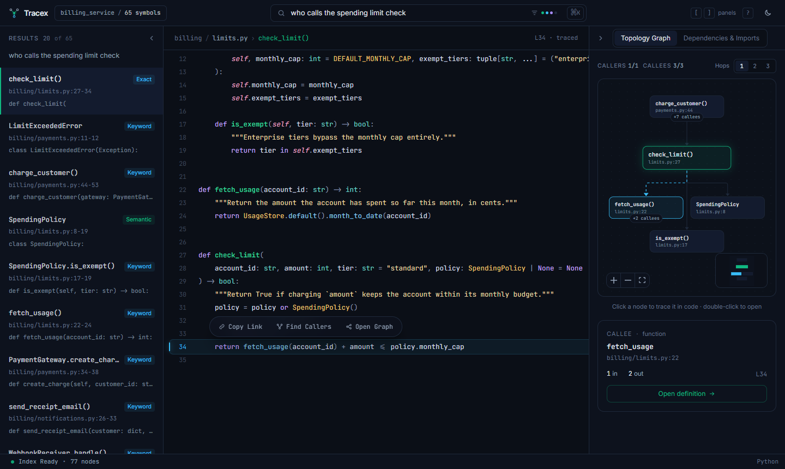
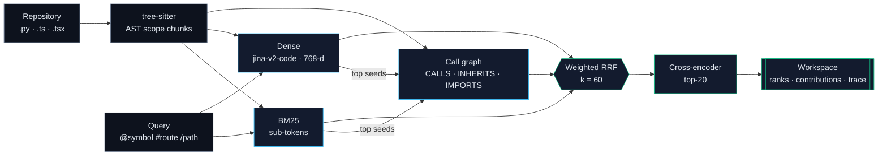
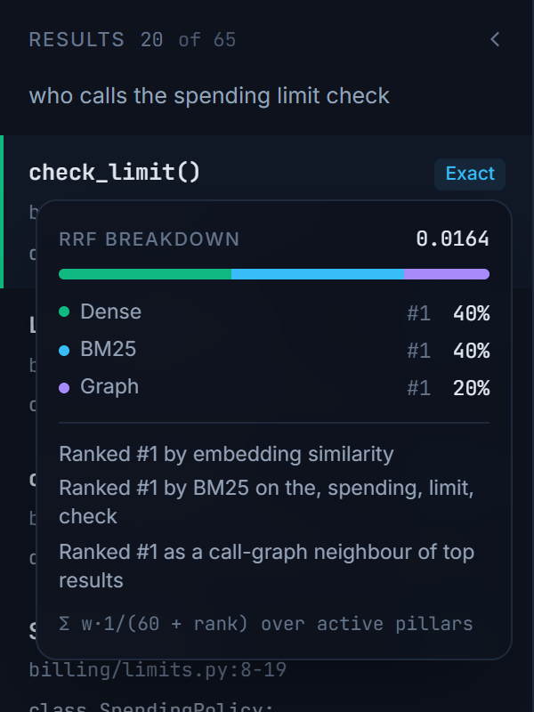
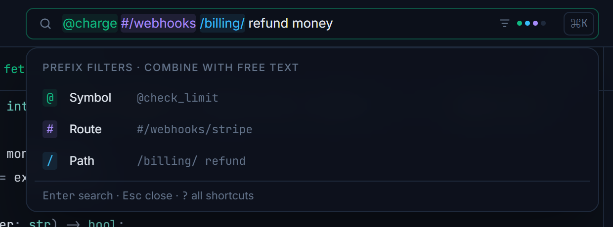
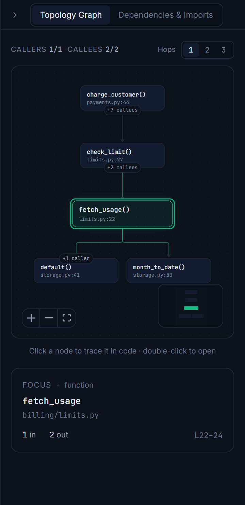
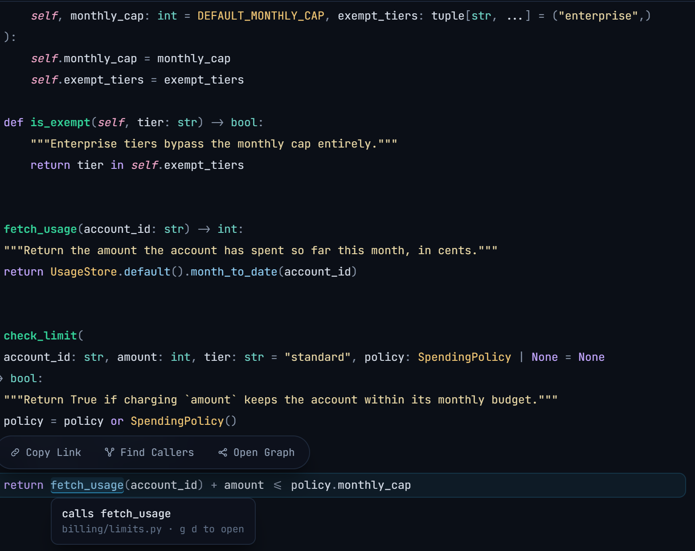

<div align="center">


<br/>

<!-- Self-hosted typing animation (regenerate: python docs/scripts/build_typing_svg.py) -->
<p align="center">
  
</p>

### AST-aware hybrid code search with explainable rank fusion

*tree-sitter scope chunks · sub-token BM25 · jina code embeddings · static call graph · weighted RRF · cross-encoder · Next.js 15 workspace*

<br/>

[**Architecture**](./docs/architecture.md)
&nbsp;·&nbsp;
[**Benchmarks**](./docs/benchmarks.md)
&nbsp;·&nbsp;
[**API Spec**](./docs/api-spec.md)
&nbsp;·&nbsp;
[**Design System**](./docs/design-system.md)
&nbsp;·&nbsp;
[**Contributing**](./CONTRIBUTING.md)
&nbsp;·&nbsp;
[**Security**](./SECURITY.md)
&nbsp;·&nbsp;
[**License**](./LICENSE)

<br/>

<!-- Retrieval engine -->
<p>
  
  
  
  
  
</p>

<!-- Workspace -->
<p>
  
  
  
  
  
  
</p>

<!-- Results (cross-validated, see docs/benchmarks.md) -->
<p>
  
  
  
  
</p>

<!-- Meta -->
<p>
  
  
  
  
  
</p>

<!-- Build status -->
<p>
  <a href="https://github.com/KrishKamra/Tracex/actions/workflows/ci-backend.yml"></a>
  <a href="https://github.com/KrishKamra/Tracex/actions/workflows/ci-frontend.yml"></a>
</p>

</div>

---

Tracex lets you ask a codebase a question, such as *"who calls the spending limit check?"* or
*"give the customer their money back"*, and lands you on the exact function and the exact
call-site lines. It parses source with tree-sitter into **scope-preserving chunks**: one
per function, method or class, never a sliding window. It then retrieves them with three
complementary signals: **sub-token BM25** for identifiers, **dense code embeddings** for
paraphrase, and a **static call graph** for structure. Weighted Reciprocal Rank Fusion
merges them, and a cross-encoder rescores the top.

Every result explains itself: per-pillar ranks, RRF contributions and matched terms. Every
design choice is backed by an ablation with confidence intervals and significance tests.
Tracex was built for a university NLP course, so the evaluation is held to research
standards: cross-validated weights, paired randomization tests and Holm correction.



<sub>Real data from the running stack: jina-embeddings-v2 + cross-encoder over the benchmark corpus. Selecting the `fetch_usage` callee traces its exact call site (line 34) in cyan.</sub>

## How it works



1. **Chunk.** Each definition becomes one chunk: signature, decorators, docstring, body
   and exact line/byte span. The call graph resolves calls across files using imports,
   `self`/`super()` and lightweight type inference.
2. **Retrieve.** BM25 and dense search each return 50 candidates. The top 10 fused results
   seed a degree-damped one-hop expansion along the call graph.
3. **Fuse.** RRF combines ranks, not scores, so the pillars never need calibrating. A
   cross-encoder rescores the fused top 20.
4. **Explain.** The workspace shows why each hit matched, and selecting a caller or callee
   highlights the exact lines in cyan.

## Results

Cross-validated, so fusion weights are never tuned on the queries they are scored on.
Mean over 37 hand-labeled queries; 95% bootstrap CIs.

| Configuration | MRR@5 | NDCG@5 | NDCG@5 lexical / semantic / structural |
|---|---:|---:|---|
| BM25 | 0.789 | 0.670 [0.56, 0.77] | 0.957 / 0.570 / 0.492 |
| Dense + BM25 | 0.864 | 0.748 [0.65, 0.84] | 0.971 / 0.709 / 0.567 |
| 🏆 **Full Tracex (CV-tuned)** | **0.897** | **0.784** [0.70, 0.86] | **1.000** / 0.692 / **0.667** |

> [!IMPORTANT]
> Only the full pipeline beats BM25 significantly after Holm correction:
> **ΔNDCG@5 = +0.114, p_adj = 0.002**. The call graph lifts structural questions
> (+0.10 NDCG@5) but costs 0.13 on lexical ones when used alone; the cross-encoder makes
> that trade free. Full analysis, error cases and threats to validity are in
> [**docs/benchmarks.md**](docs/benchmarks.md).

<picture>
  <source media="(prefers-color-scheme: dark)" srcset="docs/assets/figures/fig3-delta-forest-dark.svg">
  
</picture>

## Features

| | |
|:---:|:---:|
| <br/>**Explainable ranking**: hover any badge for its per-pillar ranks, shares and matched terms | <br/>**Prefix-aware ⌘K**: `@symbol`, `#route` and `/path` filters, highlighted live |
| <br/>**Call-graph canvas**: pan, zoom, `+N` expansion, double-click to open | <br/>**Code inspector**: grammar-accurate highlighting, resolved-call tooltips, `g d`, Shift+Click permalinks |

## Quick start

```bash
# 1 · API (Python 3.12 + uv): indexes the benchmark corpus on startup
cd backend && uv sync
TRACEX_REPO=eval/corpora/billing_service TRACEX_RERANKER=1 \
  uv run uvicorn app.api.main:app --port 8000

# 2 · Workspace (Node 22 + pnpm)
cd frontend && pnpm install && pnpm dev     # → http://localhost:3000
```

> [!TIP]
> Point `TRACEX_REPO` at your own Python/TypeScript repository, or start without it and
> index from the UI. The first run downloads the embedding model (~300 MB); indexing costs
> about 0.3 s per function on CPU.

<details>
<summary><b>Reproduce the benchmark and figures</b></summary>

```bash
cd backend
uv run pytest                                     # 142 tests, no model downloads
uv run python -m app.evaluation.benchmark \
    --output eval/reports/billing_service.md --json eval/reports/billing_service.json
uv run --group docs python ../docs/scripts/make_figures.py
```

</details>

## Repository

| Path | What's there |
|---|---|
| [`backend/app/parser`](backend/app/README.md) | tree-sitter AST engine: one chunk per definition, scope tables, call sites |
| [`backend/app/nlp`](backend/app/README.md) | Code-aware sub-tokenizer, chunk serializer, dense embedder |
| [`backend/app/retrieval`](backend/app/retrieval/README.md) | BM25, exact vector search, call graph, weighted RRF, reranker, engine |
| [`backend/app/evaluation`](backend/app/evaluation/README.md) | IR metrics, bootstrap/randomization statistics, CV weight tuning, benchmark CLI |
| [`backend/app/api`](backend/app/api/README.md) | FastAPI service with strict schemas and `Server-Timing` telemetry |
| [`backend/eval`](backend/eval) | Benchmark corpus, gold queries, committed reports |
| [`frontend`](frontend/README.md) | Next.js 15 workspace: command bar, results, inspector, topology graph |
| [`docs`](docs/README.md) | Architecture, benchmarks, API spec, design system, figures |

## Documentation

| Document | What's inside |
|---|---|
| [Architecture](docs/architecture.md) | Pipelines, data model, AST chunking, call-graph resolution, ranking math, design decisions |
| [Benchmarks](docs/benchmarks.md) | Dataset card, ablations, CIs, significance, cross-validation, error analysis, latency |
| [API spec](docs/api-spec.md) | Every endpoint with real payloads, prefixes, errors, configuration |
| [Design system](docs/design-system.md) | Tokens, typography, components, motion, syntax mapping, logo |
| [Contributing](CONTRIBUTING.md) | Setup, quality gates, contract sync, how to add gold queries |
| [Security](SECURITY.md) | Threat model and private vulnerability reporting |
| [Changelog](CHANGELOG.md) · [Citation](CITATION.cff) | Release history · how to cite Tracex |

## Authors

Built by **[Krish Kamra](https://github.com/KrishKamra)** and
**[Jash Kankariya](https://github.com/jashkankariya)**. Contributions are welcome: see
[CONTRIBUTING.md](CONTRIBUTING.md) and the [Code of Conduct](CODE_OF_CONDUCT.md).

## License

Released under the [Apache License 2.0](LICENSE); see [NOTICE](NOTICE). Models are
downloaded from the Hugging Face Hub at runtime and remain under their own licenses.

<div align="center">
<br/>
<sub>Ask in English. Land on the exact call site.</sub>
</div>
