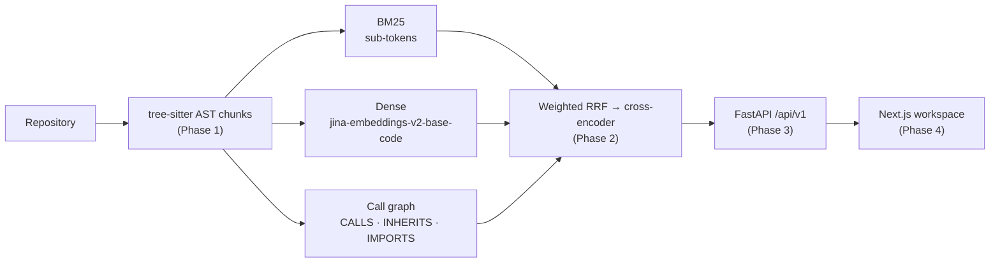

# Tracex

**AST-aware hybrid code search and dependency intelligence.** Tracex parses a repository
with tree-sitter into scope-preserving chunks. It retrieves them with three pillars
(sub-token BM25, dense code embeddings, and a call graph), fuses the results with
weighted Reciprocal Rank Fusion, and optionally reranks them with a cross-encoder. A
context-adaptive workspace UI presents the results.



| Phase | Where | Docs |
| --- | --- | --- |
| 1 · Inference layer: AST chunking, tokenizer, embeddings | `backend/app/parser`, `backend/app/nlp` | [backend/app/README.md](backend/app/README.md) |
| 2 · Hybrid retrieval, RRF, evaluation | `backend/app/retrieval`, `backend/app/evaluation` | [retrieval](backend/app/retrieval/README.md) · [evaluation](backend/app/evaluation/README.md) |
| 3 · REST API | `backend/app/api` | [backend/app/api/README.md](backend/app/api/README.md) |
| 4 · Workspace UI | `frontend/` | [frontend/README.md](frontend/README.md) |

## Quick start

```bash
# 1. API: indexes the benchmark corpus at startup (Python 3.12, uv)
cd backend
uv sync
TRACEX_REPO=eval/corpora/billing_service TRACEX_RERANKER=1 uv run uvicorn app.api.main:app --port 8000

# 2. UI (Node 22, pnpm)
cd frontend
pnpm install
pnpm dev        # http://localhost:3000
```

> [!TIP]
> To index your own code, open the UI before setting `TRACEX_REPO` and enter a
> repository path, or call `POST /api/v1/index` with `{"path": ...}`.

## Results

On a hand-labeled benchmark (37 queries, 85 graded judgements), the full pipeline with
cross-validated fusion weights reaches **NDCG@5 = 0.784**. That is significantly above
BM25 (0.670; paired randomization test, Holm-adjusted p = 0.002). See the
[evaluation README](backend/app/evaluation/README.md) for the ablations, confidence
intervals and the effect of the graph pillar.

## Tests

```bash
cd backend && uv run pytest          # 142 tests
cd frontend && pnpm test             # 55 tests
```
