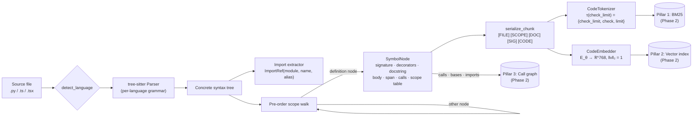
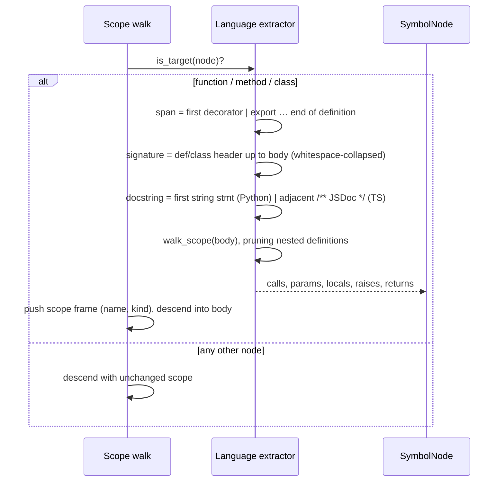

# Tracex Inference Layer (Phase 1)

The inference layer turns a repository into **scope-preserving AST chunks** and
represents each chunk twice: as **sub-token lexical terms** for the sparse BM25
pillar, and as an **L2-normalized dense vector** for the semantic pillar.

> [!IMPORTANT]
> Chunks are never produced by character or token windows. Every chunk is exactly
> one AST definition node (function, method or class). Its signature, decorators,
> docstring and body therefore always stay together, and its coordinates map back
> to the source exactly.

| Module | Responsibility |
| --- | --- |
| [`parser/ast_engine.py`](parser/ast_engine.py) | Tree-sitter parsing (Python, TypeScript, TSX) → `SymbolNode` chunks |
| [`nlp/tokenizer.py`](nlp/tokenizer.py) | camelCase / PascalCase / snake_case / numeric identifier splitting |
| [`nlp/serializer.py`](nlp/serializer.py) | `[DOC] … [SIG] … [CODE] …` structured serialization |
| [`nlp/embeddings.py`](nlp/embeddings.py) | Bi-encoder wrapper: device detection, fallback, deterministic batching, LRU cache |

## Pipeline



## AST scope traversal

The walk is iterative and pre-order, so chunks come out in source order. A
definition node opens a new scope frame. Its children are walked with that frame
pushed, which gives nested definitions qualified names such as
`WebhookReceiver.handle._audit`.



> [!NOTE]
> **Attribution rule.** `calls`, `raises`, `returns` and `locals` belong to the
> innermost *named* definition. A nested `def`/arrow function is its own chunk and
> is pruned from its parent. Code inside an *anonymous* callback still counts toward
> the parent's `calls` (the callback runs on the parent's behalf). Its `return`
> statements and locals do not. Decorator calls run in the enclosing scope, so they
> are attributed to the parent.

### Span and coordinate conventions

* Lines are **1-indexed and inclusive**. `start_byte`/`end_byte` slice the raw
  file bytes exactly.
* A span starts at the first decorator, or at the `export` keyword in TypeScript.
  Leading JSDoc is captured in `docstring` but is **not** part of the span.
* Class chunks store a **skeleton** body: member bodies are elided to
  `def m(self): ...` / `m() { ... }`. Members are their own chunks, so repeating
  their bodies would double-count their tokens in both pillars.
* Symbol ids are `"{file_path}::{qualified_name}"`. Redefinitions, such as a
  property getter and setter, get an `@L{start_line}` suffix.

## Structured serialization (§3.1)

$$\text{Serialize}(c_i) = \texttt{[FILE] } f_i \oplus \texttt{[SCOPE] } s_i \oplus \texttt{[DOC] } d_i \oplus \texttt{[SIG] } \text{sig}_i \oplus \texttt{[CODE] } b_i$$

where $\oplus$ is newline-delimited concatenation. `[FILE]`/`[SCOPE]` are emitted
with `include_context=True` (the default for embedding). Decorators open the
`[SIG]` segment, because routes like `@router.post("/webhook")` carry strong signal.

```text
[FILE] sample_service.py
[SCOPE] WebhookReceiver.validate_signature (method)
[DOC] Return True when the HMAC signature matches the payload.
[SIG] @staticmethod
@retry(times=3)
def validate_signature(payload: bytes, signature: str) -> bool
[CODE] digest = hashlib.sha256(payload).hexdigest()
...
```

## Code-aware sub-tokenization (§3.2)

$$\tau(\texttt{check\_limit}) = \{\texttt{check\_limit}, \texttt{check}, \texttt{limit}\}$$

The original identifier is kept (for exact-symbol queries) and followed by its
sub-tokens (for natural-language queries). Language keywords are matched
case-sensitively and never split, so `Type` stays an identifier while `type` is a
keyword. Structural tags (`[DOC]`, `[SIG]`, …) are stripped before tokenizing.

> [!TIP]
> `CodeTokenizer(keep_keywords=False)` drops language keywords. This gives a cheap
> ablation for the Phase 2 benchmark: does syntactic vocabulary help or hurt BM25?

## Dense bi-encoder (§3.3)

$$\text{Score}_{\text{Dense}}(c_i, Q) = \frac{E_{\theta}(Q)^\top E_{\theta}(c_i)}{\|E_{\theta}(Q)\|_2\,\|E_{\theta}(c_i)\|_2}$$

`CodeEmbedder` L2-normalizes every vector, so cosine similarity becomes a dot product.

* **Models:** `jinaai/jina-embeddings-v2-base-code` (768-d) → fallback `BAAI/bge-m3`.
  `sentence-transformers/all-MiniLM-L6-v2` is the small CI model.
* **Device:** `TRACEX_DEVICE` override, else CUDA → XPU (Intel GPU) → NPU (Ascend,
  via `torch_npu`) → MPS → CPU.
* **Deterministic batching:** unique texts are ordered by (descending length, first
  occurrence) and cut into fixed `batch_size` batches. Batch composition therefore
  depends only on the input set.
* **Cache:** a bounded LRU keyed by the SHA-256 of the serialized text. Duplicates
  within a single call are encoded once.

> [!WARNING]
> jina-embeddings-v2 runs custom Hub code that imports helpers removed in
> **transformers 5.x**. `pyproject.toml` therefore pins `transformers<5`. Without the
> pin, the embedder silently falls back to the next model (the failure is logged).
> `trust_remote_code` is enabled **only** for models listed in `REMOTE_CODE_MODELS`.

## Tests

```bash
uv run pytest                                   # fast suite, no model download
TRACEX_RUN_SLOW=1 uv run pytest -m slow         # real MiniLM model
TRACEX_RUN_SLOW=1 TRACEX_EMBED_MODEL=jinaai/jina-embeddings-v2-base-code uv run pytest -m slow
```
