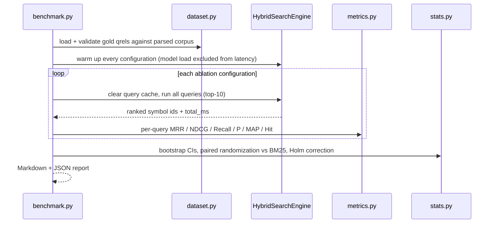
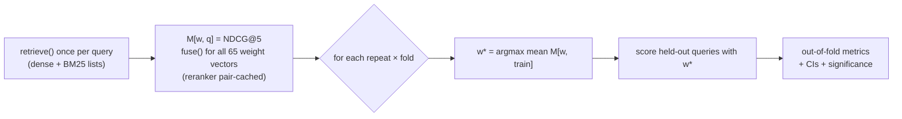

# Tracex Evaluation Suite

An ablation benchmark that isolates each pillar's contribution, with confidence
intervals and significance tests so that claims are statistically defensible.

```bash
uv run python -m app.evaluation.benchmark \
    --output eval/reports/billing_service.md --json eval/reports/billing_service.json
# --no-reranker, --model <hf-id>, --device cpu|cuda, --resamples N, --seed S
```



## Metrics ([`metrics.py`](metrics.py))

| Metric | Definition |
| --- | --- |
| MRR@K | $\frac{1}{\|Q\|}\sum_i \frac{1}{\text{rank}_i}$ (0 if no relevant doc in the top K) |
| NDCG@K | $\text{DCG@K}/\text{IDCG@K}$, with $\text{DCG@K}=\sum_{p=1}^{K}\frac{2^{\text{rel}_p}-1}{\log_2(p+1)}$ on graded labels |
| Recall@K | relevant docs retrieved in the top K / all relevant docs |
| P@K | relevant docs retrieved in the top K / K |
| MAP@K | $\frac{1}{\min(\|R\|,K)}\sum_{p\le K,\,d_p\in R} P@p$ |
| Hit@K | 1 if any relevant doc is in the top K (Success@K) |

## Statistics ([`stats.py`](stats.py))

- **95% percentile bootstrap CI** (10,000 query resamples) for MRR@5, NDCG@5 and Recall@5.
- **Paired approximate randomization test** (sign-flip, 10,000 permutations) of each
  configuration against the BM25 baseline. Smucker et al. (CIKM 2007) recommend it for IR.
- **Holm–Bonferroni** correction across all 8 comparisons (4 systems × 2 metrics).

> [!IMPORTANT]
> With 37 queries, a +0.08 NDCG difference can still fail significance after
> correction. Report the CIs and the adjusted p-values, not just the means.

## Gold dataset ([`eval/datasets/billing_service.json`](../../eval/datasets/billing_service.json))

The corpus is a 12-file billing service: a Python backend plus a TypeScript/React
client, 65 AST chunks. It has 37 queries and 85 graded judgements
(2 = primary answer, 1 = direct collaborator), in three categories:

| Category | Probes | Example |
| --- | --- | --- |
| lexical (12) | exact identifiers / API names | `compute_backoff jitter` |
| semantic (13) | paraphrase with little identifier overlap | *"turn a dollar amount the user typed into a number of cents"* |
| structural (12) | call relationships and data flow | *"who calls the spending limit check"* |

Every judgement references a `symbol_id`, and the loader validates them against the
parsed corpus, so renaming a symbol fails loudly instead of silently deflating scores.

## Results (jina-embeddings-v2-base-code, ms-marco-MiniLM-L-6-v2, CPU)

Full report: [`eval/reports/billing_service.md`](../../eval/reports/billing_service.md).

| Configuration | MRR@5 | NDCG@5 | Recall@5 | NDCG@5 lexical / semantic / structural |
| --- | --- | --- | --- | --- |
| BM25 | 0.789 | 0.670 | 0.715 | 0.957 / 0.570 / 0.492 |
| Dense | 0.845 | 0.766 | 0.791 | 0.975 / 0.720 / 0.606 |
| Dense + BM25 | 0.864 | 0.748 | 0.790 | 0.971 / 0.709 / 0.567 |
| Dense + BM25 + Graph | 0.764 | 0.690 | 0.737 | 0.839 / 0.576 / **0.666** |
| Full Tracex (+ Reranker) | **0.909** | **0.796** | 0.790 | **1.000** / **0.727** / **0.667** |

> [!NOTE]
> **Findings.**
> 1. Only the full pipeline beats BM25 significantly after Holm correction
>    (ΔNDCG@5 = +0.126, p_adj < 0.001; ΔMRR@5 = +0.120, p_adj = 0.008).
> 2. The graph pillar raises structural NDCG@5 (+0.10 over Dense + BM25) but pulls
>    1-hop neighbours above direct matches on lexical and semantic queries.
>    Added on its own, it is a net loss.
> 3. The ms-marco cross-encoder was trained on web passages, yet it repairs that
>    ordering: it restores direct matches while keeping the structural gains.

## Cross-validated weight tuning ([`tuning.py`](tuning.py))

Choosing RRF weights on the same queries that you report is test-set overfitting.
`tuning.py` therefore selects weights by **3× repeated, category-stratified 5-fold
cross-validation** over the 65-point simplex grid (step 0.1), maximizing NDCG@5 on
the training folds. Each query is scored only by weights chosen without it.



| System | MRR@5 | NDCG@5 | Recall@5 |
| --- | --- | --- | --- |
| Dense + BM25 + Graph, default weights | 0.764 | 0.690 | 0.737 |
| Dense + BM25 + Graph, **CV-tuned** | 0.800 | 0.729 | 0.803 |
| Full Tracex, default weights | 0.909 | 0.796 | 0.790 |
| Full Tracex, **CV-tuned** | 0.897 | 0.784 | 0.775 |

> [!IMPORTANT]
> **The reportable headline is the CV-tuned full pipeline: NDCG@5 = 0.784,
> significantly above BM25 (Δ = +0.114, p_adj = 0.002).** It sits slightly below the
> default weights' 0.796. This is the expected optimism gap between in-sample and
> held-out estimates: the in-sample optimum is only 0.800, so the default weights
> were already near-optimal.

Further findings from the full report:

- Without the reranker, CV keeps choosing dense-heavy weights with w_graph = 0
  (10 of 15 folds). The graph pillar does not help unless something reorders its candidates.
- With the reranker, NDCG@5 is nearly flat across graph weights (0.784–0.800). The
  cross-encoder makes the system robust to the fusion weights.
- Per-fold held-out NDCG@5 ranges from 0.444 to 0.898 without the reranker and from
  0.560 to 0.923 with it. With 37 queries, a single split would be an unreliable
  estimate, which is why the CV is repeated.
