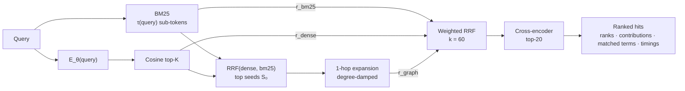
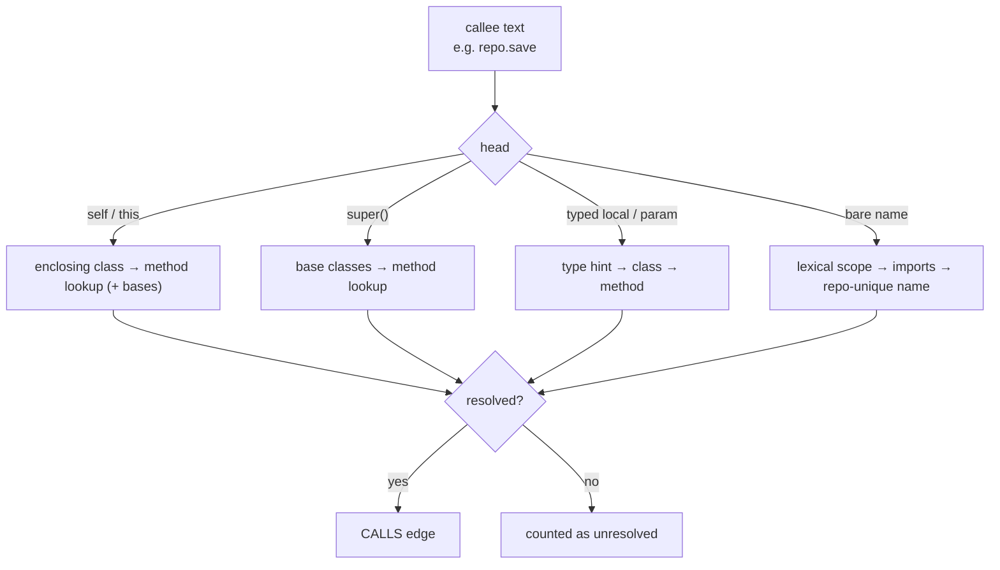

# Tracex Hybrid Retrieval (Phase 2)

Three retrieval pillars over the Phase 1 AST chunks. Their outputs are fused by
weighted Reciprocal Rank Fusion and optionally rescored by a cross-encoder.

| Module | Pillar / stage |
| --- | --- |
| [`bm25_index.py`](bm25_index.py) | Pillar 1: sub-token Okapi BM25, with matched-term explanations |
| [`vector_index.py`](vector_index.py) | Pillar 2: exact cosine search over unit vectors |
| [`call_graph.py`](call_graph.py) | Pillar 3: NetworkX code property graph (CALLS / INHERITS / IMPORTS) + 1-hop expansion |
| [`rrf_fusion.py`](rrf_fusion.py) | Weighted RRF with per-pillar rank and contribution breakdown |
| [`reranker.py`](reranker.py) | Cross-encoder reranking of the fused head |
| [`engine.py`](engine.py) | `HybridSearchEngine`: orchestration and per-stage latency telemetry |

## Formulations

**BM25** (k₁ = 1.2, b = 0.75, Lucene's non-negative IDF):

$$\text{Score}(D,Q)=\sum_{q\in Q}\ln\left(1+\frac{N-n(q)+0.5}{n(q)+0.5}\right)\frac{f(q,D)(k_1+1)}{f(q,D)+k_1\left(1-b+b\frac{|D|}{\text{avgdl}}\right)}$$

**Dense:** $\text{Score}(c_i,Q)=E_\theta(Q)^\top E_\theta(c_i)$ on L2-normalized vectors. This equals cosine similarity.

**Graph expansion** over seeds $S_0$:

$$\text{Score}_{\text{Graph}}(u)=\sum_{v\in S_0,\ (u,v)\in E\ \lor\ (v,u)\in E}\frac{\text{Score}_{\text{Seed}}(v)}{1+\ln(1+\deg(u))}$$

**Weighted RRF:** $\text{RRF}(d)=\sum_m \frac{w_m}{k+r_m(d)}$, with $\sum_m w_m=1$ over the active pillars.
The defaults are $w = (0.4, 0.4, 0.2)$ for (dense, BM25, graph).

> [!NOTE]
> RRF uses only ranks. BM25 scores (unbounded), cosine similarities ([-1, 1]) and
> graph scores therefore never need calibration against each other. Ties break
> deterministically: by best single-pillar rank, then by symbol id.

## Call resolution and type inference

Receivers are typed by flow-insensitive inference over:

- parameter annotations (`gateway: PaymentGateway`, `SpendingPolicy | None`)
- constructor and factory assignments recorded by the parser in `ScopeDetails.type_hints`
  (`repo = PaymentRepository()`, `self.audit = AuditLog()`)
- return annotations (`UsageStore.default().increment`)

> [!WARNING]
> On the benchmark corpus 36% of call names resolve. Nearly all unresolved names
> are builtins (`round`, `sum`) or third-party APIs (`requests.post`,
> `sqlite3.connect`), which have no definitions in the repository. The known
> in-repo misses are calls through module-level instances
> (`RECEIPT.render`, `client.getInvoices`).

## Two-stage API

`HybridSearchEngine.search()` is `fuse(retrieve(query))`:

- `retrieve()` runs the weight-independent first stage (query embedding, dense
  and BM25 candidate lists) and returns a reusable `PillarRankings`.
- `fuse()` runs graph expansion, weighted RRF and reranking for a given `SearchConfig`.

Weight tuning reuses one `retrieve()` per query across all 65 grid points. Both
stages accept `allowed`, a candidate restriction that the API uses for the
`@symbol` / `#route` / `/path` prefix filters.

CALLS edges carry the call-site `lines` in the caller (`CallGraph.call_lines`), and
`CallGraph.resolve(caller, callee)` returns the exact definition each call resolved
to. The inspector uses these for its cyan "trace" highlights.

## Telemetry

`SearchResult.timings_ms` reports `embedding_ms`, `dense_ms`, `bm25_ms`, `ast_graph_ms`,
`rrf_ms`, `rerank_ms` and `total_ms`. Each hit carries `ranks`, `contributions`,
`match_origin` and `matched_terms`, which feed the Phase 4 RRF explainability popover.
