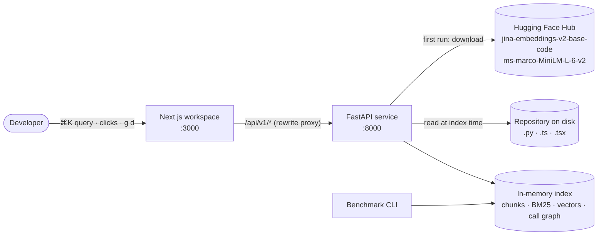
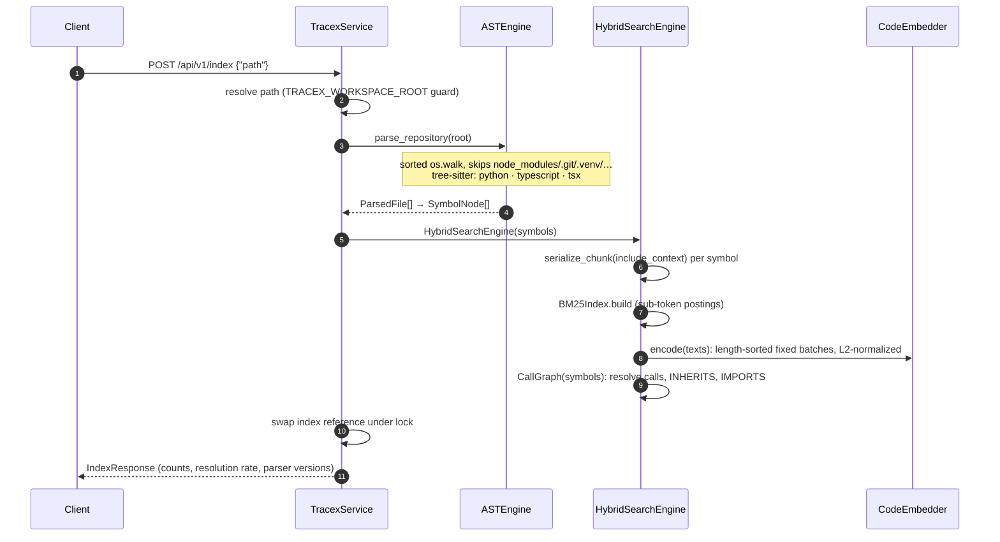
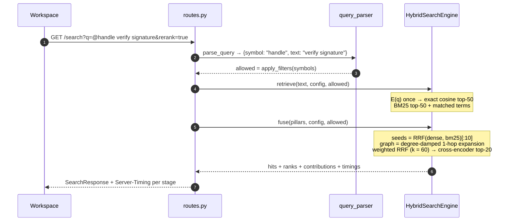
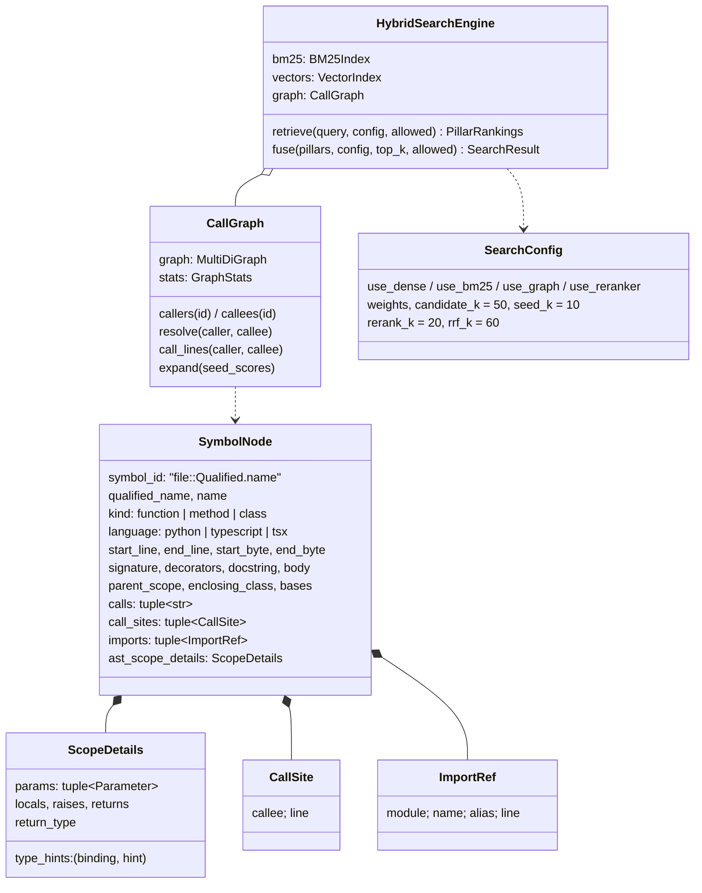
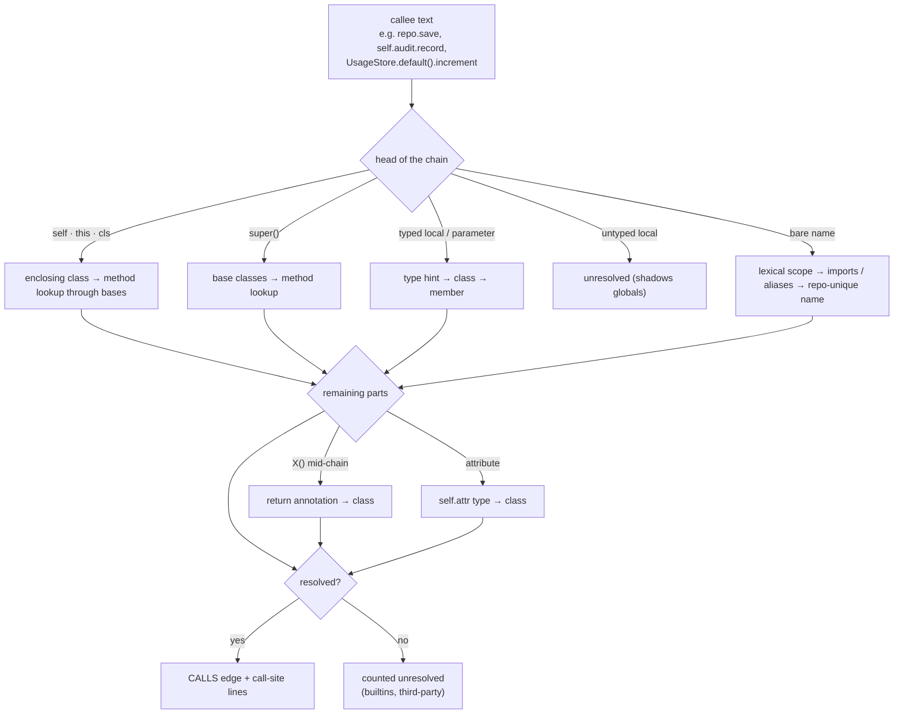
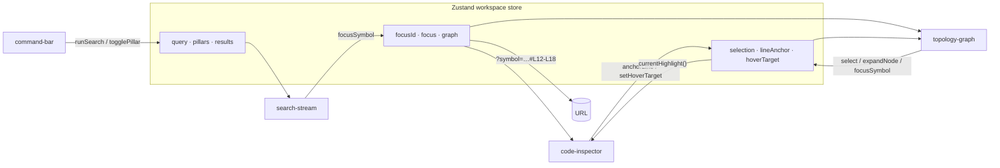

# Architecture

Tracex answers natural-language and identifier questions about a codebase by retrieving
**AST-scoped chunks** with three complementary signals. It explains each result and
links it to the exact call sites in the source.

> [!NOTE]
> Design principles: **deterministic** (sorted traversal; every ranking tie broken by
> symbol id), **explainable** (every hit carries per-pillar ranks, contributions and
> matched terms), and **measured** (every component is justified by an ablation in
> [benchmarks.md](benchmarks.md)).

<details>
<summary><b>Contents</b></summary>

1. [System context](#1-system-context)
2. [Repository layout](#2-repository-layout)
3. [Indexing pipeline](#3-indexing-pipeline)
4. [Query pipeline](#4-query-pipeline)
5. [Core data model](#5-core-data-model)
6. [AST chunking](#6-ast-chunking)
7. [Call graph and name resolution](#7-call-graph-and-name-resolution)
8. [Ranking](#8-ranking)
9. [Frontend architecture](#9-frontend-architecture)
10. [State, concurrency and caching](#10-state-concurrency-and-caching)
11. [Performance profile](#11-performance-profile)
12. [Design decisions](#12-design-decisions)
13. [Limitations and roadmap](#13-limitations-and-roadmap)

</details>

---

## 1. System context



The service is stateless apart from one immutable in-memory index. Restarting with
`TRACEX_REPO` rebuilds it. There is no database, so the whole system runs on a laptop.

## 2. Repository layout

```text
tracex/
├── backend/                     Python 3.12 · uv
│   ├── app/
│   │   ├── parser/              Phase 1 · tree-sitter AST engine → SymbolNode chunks
│   │   ├── nlp/                 Phase 1 · tokenizer, serializer, dense embedder
│   │   ├── retrieval/           Phase 2 · BM25, vectors, call graph, RRF, reranker, engine
│   │   ├── evaluation/          Phase 2 · metrics, statistics, CV tuning, benchmark CLI
│   │   └── api/                 Phase 3 · FastAPI routes, schemas, prefix parser, service
│   ├── eval/                    benchmark corpus, gold queries, committed reports
│   └── tests/                   142 pytest tests
├── frontend/                    Next.js 15 · TypeScript · pnpm
│   ├── src/components/          command-bar · search-stream · code-inspector · topology-graph · chrome
│   ├── src/store/               Zustand workspace store (focus sync)
│   ├── src/lib/                 API client, highlighter, graph layout, RRF explainers
│   └── tests/                   55 Vitest tests over real API payloads
└── docs/                        this documentation, figures and their generators
```

## 3. Indexing pipeline



Models load once per process, and the cross-encoder runs one warm-up pass at that point, so
no user request pays a cold start. Embedding dominates indexing cost: about 0.3 s per chunk on CPU.

## 4. Query pipeline



The split between `retrieve()` and `fuse()` is deliberate. The first stage doesn't depend on
fusion weights, so weight tuning reuses one retrieval per query across all 65 grid points
([benchmarks §6](benchmarks.md#6-cross-validated-fusion-weights)).

## 5. Core data model



## 6. AST chunking

Every function, method and class becomes exactly **one chunk**. Character windows never
split a body or separate a docstring from its signature.

| Rule | Behaviour |
|---|---|
| Span | From the first decorator (or `export`) to the end of the definition. Lines are 1-indexed and inclusive; byte offsets are exact. |
| Docstring | The Python docstring statement, or the adjacent `/** JSDoc */`. Excluded from `body`. |
| Class body | Stored as a skeleton (`def m(self): ...`). Members are their own chunks, so their tokens are never counted twice. |
| Nested definitions | Separate chunks with qualified names (`Outer.method.inner`), pruned from the parent's calls, locals and returns. |
| Anonymous callbacks | Calls count for the enclosing chunk; `return`s and locals inside them don't. |
| Ids | `file::Qualified.name`. Redefinitions (getter/setter) get a stable `@L<line>` suffix. |

Each chunk is serialized for the encoders as:

```text
[FILE] billing/limits.py
[SCOPE] check_limit (function)
[DOC] Return True if charging `amount` keeps the account within its monthly budget.
[SIG] def check_limit(account_id: str, amount: int, tier: str = "standard", ...) -> bool
[CODE] policy = policy or SpendingPolicy()
...
```

The sparse tokenizer splits identifiers on snake_case, camelCase, PascalCase and digit
boundaries, and keeps the original identifier too:
τ(`check_limit`) = {`check_limit`, `check`, `limit`}.

## 7. Call graph and name resolution



Receivers are typed by **flow-insensitive inference** over three sources:

- parameter annotations (`gateway: PaymentGateway`, `SpendingPolicy | None`)
- constructor and factory assignments (`repo = PaymentRepository()`, `self.audit = AuditLog()`)
- return annotations (`UsageStore.default() -> "UsageStore"`)

On the benchmark corpus, 51 of 140 call names (36%) resolve. Nearly all the rest are
builtins and third-party APIs, which have no definitions in the repository.

## 8. Ranking

| Stage | Formula | Notes |
|---|---|---|
| BM25 | $\sum_q \ln\!\left(1+\frac{N-n_q+0.5}{n_q+0.5}\right)\frac{f(q,D)(k_1+1)}{f(q,D)+k_1(1-b+b\,\|D\|/\text{avgdl})}$ | k₁ = 1.2, b = 0.75, Lucene's non-negative IDF; query terms deduplicated |
| Dense | $E_\theta(Q)^\top E_\theta(c_i)$ on unit vectors | exact search, so ANN recall never confounds an ablation |
| Graph | $\sum_{v\in S_0,\,(u,v)\in E}\frac{s(v)}{1+\ln(1+\deg u)}$ | 1-hop over CALLS + INHERITS; degree damping tames hubs |
| Fusion | $\sum_m \frac{w_m}{k + r_m(d)}$, k = 60 | rank-only: no score calibration across pillars |
| Rerank | $\sigma(f_\text{cross}(Q \oplus c_i))$ on the fused top-20 | pair scores cached (LRU) |

## 9. Frontend architecture



* **Bi-directional sync.** A search focuses the top hit, and focusing loads `/symbol`
  and `/graph` in parallel. Selecting a callee node traces its exact `call_lines`
  in cyan. Stale responses are dropped, so the last click wins.
* **Highlighting** runs Shiki TextMate grammars (lazy-loaded) whose scope stacks map onto
  the golden `tk-*` palette ([design-system.md](design-system.md#syntax-highlighting)).
* **React Flow** nodes live in `useNodesState` so measured sizes survive selection
  changes. Rebuilt node objects would make React Flow hide them for a frame.

## 10. State, concurrency and caching

| Concern | Approach |
|---|---|
| Index swaps | Built off to the side, then swapped under a lock. Searches always see a complete index. |
| Model lifetime | Loaded once per process; the cross-encoder is warmed at index time. |
| Query embeddings | Bounded LRU keyed by the SHA-256 of the text. |
| Rerank scores | LRU keyed by (query, chunk), so tuning sweeps rescore for free. |
| Frontend requests | Searches are abortable; focus loads use a monotonically increasing token. |

## 11. Performance profile

| Stage | Typical cost (CPU) |
|---|---|
| Query embedding (jina, 768-d) | ≈ 25–90 ms; dominates non-reranked latency |
| Dense exact search (65 × 768) | < 1 ms |
| BM25 | < 1 ms |
| Graph expansion + RRF | ≈ 1 ms |
| Cross-encoder, 20 pairs | ≈ 0.6–0.9 s |
| Indexing | ≈ 0.3 s per chunk (embedding); BM25 and graph < 10 ms total |

Full distributions are in [benchmarks §8](benchmarks.md#8-latency).

## 12. Design decisions

| Decision | Why | Alternative rejected |
|---|---|---|
| AST chunks, not windows | A chunk is a unit a developer navigates to, with intact signature and docstring | Sliding windows split bodies and orphan docstrings |
| Rank-based RRF | Pillar scores live on incompatible scales (BM25 unbounded, cosine in [−1, 1]) | Score normalization needs per-corpus calibration |
| Exact cosine search | At repo scale it's sub-millisecond, and evaluation stays exact | ANN (HNSW): unnecessary approximation here |
| Lucene IDF (+1) | A common term can never penalize a match | Classic Robertson IDF goes negative |
| Class skeleton bodies | Members are separate chunks, so this avoids double-counting | Full class text inflates long classes |
| CV-tuned weights reported | Honest held-out estimate | Tuning on the test queries |
| `transformers<5` pin | jina-v2's remote code imports helpers removed in v5 | Silent fallback to another model |
| Non-draggable graph nodes | Layout is automatic, and double-click means "open definition" | Free dragging, which fights the layered layout |

## 13. Limitations and roadmap

* **Scale.** Everything is in memory and indexing is synchronous. Large monorepos
  need incremental indexing and a GPU (or a smaller encoder).
* **Languages.** Python, TypeScript and TSX. Go and Java need new extractors; the
  traversal machinery is language-agnostic.
* **Type inference** is intentionally shallow. Calls through module-level instances
  (`client.getInvoices`) remain unresolved.
* **Evaluation** uses one author-built corpus. The next step is adapters for public
  code-search sets (CodeSearchNet, CoSQA).
