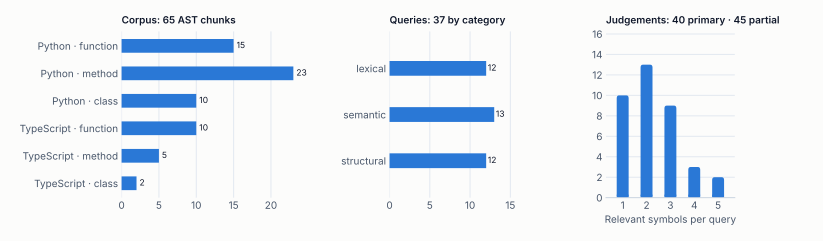
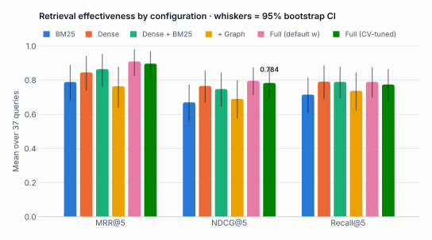
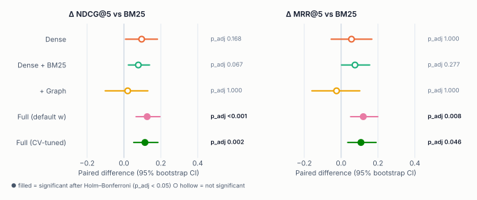
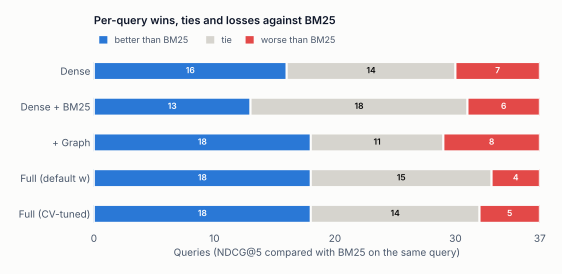
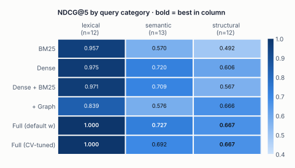
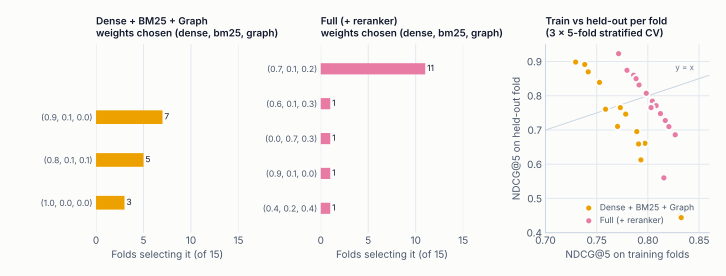
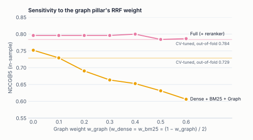
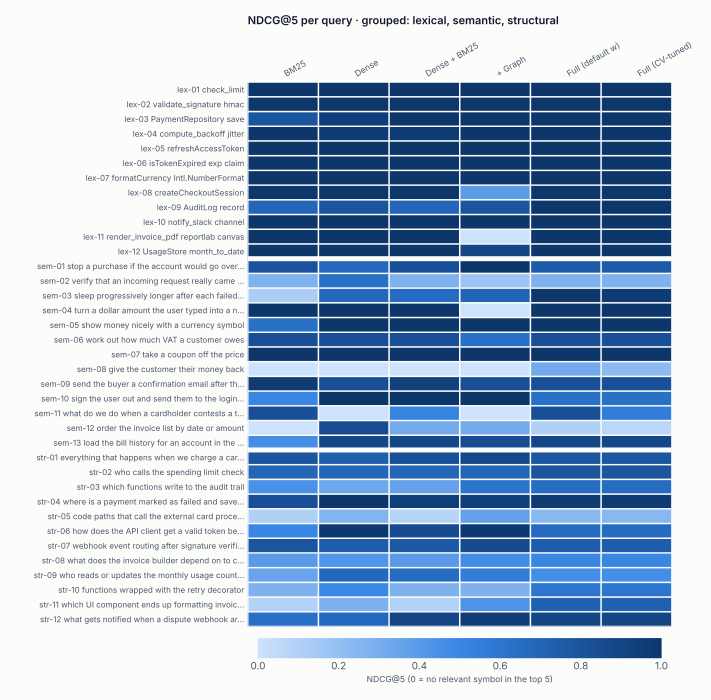
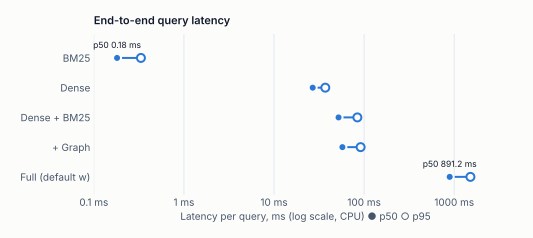

# Benchmarks & statistical evaluation

How well Tracex retrieves code, which components earn their place, and how
confident we can be in each claim. Every number on this page is computed from the
committed report
[`backend/eval/reports/billing_service.json`](../backend/eval/reports/billing_service.json),
and every figure is regenerated from it by
[`docs/scripts/make_figures.py`](scripts/make_figures.py).

> [!IMPORTANT]
> **Headline (cross-validated, held-out):** the full pipeline reaches
> **NDCG@5 = 0.784** (95% CI 0.699–0.864) and **MRR@5 = 0.897**. That is significantly
> above the BM25 baseline: **ΔNDCG@5 = +0.114, Holm-adjusted p = 0.002**. Fusion
> weights were chosen by cross-validation, so no query is scored by weights tuned on
> itself.

<details>
<summary><b>Contents</b></summary>

1. [Setup](#1-setup) · [dataset card](#dataset-card)
2. [Metrics](#2-metrics)
3. [Effectiveness](#3-effectiveness)
4. [Significance](#4-significance)
5. [Where each pillar helps](#5-where-each-pillar-helps)
6. [Cross-validated fusion weights](#6-cross-validated-fusion-weights)
7. [Error analysis](#7-error-analysis)
8. [Latency](#8-latency)
9. [Threats to validity](#9-threats-to-validity)
10. [Reproducing every number](#10-reproducing-every-number)

</details>

---

## 1. Setup

| | |
|---|---|
| **Corpus** | `backend/eval/corpora/billing_service`: a Python billing backend and a TypeScript/React client. 13 files, **65 AST chunks**. |
| **Queries** | **37** hand-written queries in three categories, with **85 graded judgements**. |
| **Dense encoder** | `jinaai/jina-embeddings-v2-base-code` (768-d, L2-normalized, max 512 tokens) |
| **Cross-encoder** | `cross-encoder/ms-marco-MiniLM-L-6-v2`, applied to the fused top-20 |
| **Fusion** | Weighted RRF, k = 60. Default weights (dense, bm25, graph) = (0.4, 0.4, 0.2). |
| **Hardware** | CPU only (no CUDA), single process |
| **Statistics** | 10,000 bootstrap resamples · 10,000 randomization permutations · seed 0 |

Five ablations isolate each component; two CV-tuned variants re-select fusion weights per fold.

| Configuration | Dense | BM25 | Graph | Reranker |
|---|:---:|:---:|:---:|:---:|
| BM25 *(baseline)* | | ✔ | | |
| Dense | ✔ | | | |
| Dense + BM25 | ✔ | ✔ | | |
| Dense + BM25 + Graph | ✔ | ✔ | ✔ | |
| Full Tracex | ✔ | ✔ | ✔ | ✔ |
| … (CV-tuned) | weights chosen by 3 × 5-fold CV | | | |

### Dataset card

<picture>
  <source media="(prefers-color-scheme: dark)" srcset="assets/figures/fig9-dataset-dark.svg">
  
</picture>

| Category | n | What it probes | Example |
|---|---:|---|---|
| lexical | 12 | Identifier- and API-bearing queries | `compute_backoff jitter` |
| semantic | 13 | Paraphrases with little identifier overlap | *turn a dollar amount the user typed into a number of cents* |
| structural | 12 | Questions about call relationships and data flow | *who calls the spending limit check* |

Judgements are graded: **2** marks the primary answer (40 judgements), and **1** marks a direct
collaborator, i.e. a caller, callee or owning class (45 judgements). Every judgement
references a `symbol_id`, and the loader validates each one against the parsed
corpus. A renamed symbol fails the benchmark loudly instead of silently scoring 0.

> [!WARNING]
> The queries and labels were written by the system's authors. There is no
> inter-annotator agreement and no external test collection. Treat the absolute numbers
> as indicative; the paired comparisons between configurations are the robust part.
> See [threats to validity](#9-threats-to-validity).

## 2. Metrics

All metrics are computed per query, then averaged; K = 5 unless stated. Binary metrics count grade ≥ 1 as relevant.

| Metric | Definition | Reads as |
|---|---|---|
| MRR@K | $\frac{1}{\|Q\|}\sum_q \frac{1}{\text{rank}_q}$ (0 if nothing relevant in the top K) | How high the first useful hit sits |
| NDCG@K | $\frac{\text{DCG@K}}{\text{IDCG@K}}$, $\;\text{DCG@K}=\sum_{p=1}^{K}\frac{2^{\text{rel}_p}-1}{\log_2(p+1)}$ | Graded ranking quality; rewards the primary answer most |
| Recall@K | relevant in top K / all relevant | Coverage of the answer set |
| P@K | relevant in top K / K | Precision of the visible list |
| MAP@K | $\frac{1}{\min(\|R\|,K)}\sum_{p\le K,\,d_p\in R}P@p$ | Precision averaged at each relevant hit |
| Hit@1 | 1 if the top result is relevant | "Did the first answer work?" |

Implementation: [`backend/app/evaluation/metrics.py`](../backend/app/evaluation/metrics.py), unit-tested against hand-computed values.

## 3. Effectiveness

<picture>
  <source media="(prefers-color-scheme: dark)" srcset="assets/figures/fig1-ablation-dark.svg">
  
</picture>

| Configuration | MRR@5 | NDCG@5 | Recall@5 | P@5 | MAP@5 | Hit@1 | Recall@10 |
|---|---:|---:|---:|---:|---:|---:|---:|
| BM25 | 0.789 | 0.670 | 0.715 | 0.286 | 0.612 | 0.676 | 0.822 |
| Dense | 0.845 | 0.766 | 0.791 | 0.330 | 0.698 | 0.784 | 0.909 |
| Dense + BM25 | 0.864 | 0.748 | 0.790 | 0.330 | 0.694 | 0.811 | 0.897 |
| Dense + BM25 + Graph | 0.764 | 0.690 | 0.737 | 0.330 | 0.628 | 0.676 | 0.893 |
| Full Tracex | **0.909** | **0.796** | 0.790 | 0.324 | **0.715** | **0.865** | 0.875 |
| Dense + BM25 + Graph (CV-tuned) | 0.800 | 0.729 | **0.803** | **0.341** | 0.663 | 0.721 | **0.913** |
| **Full Tracex (CV-tuned)** | 0.897 | 0.784 | 0.775 | 0.317 | 0.706 | 0.856 | 0.873 |

<details>
<summary><b>95% percentile-bootstrap confidence intervals</b> (10,000 query resamples)</summary>

| Configuration | MRR@5 | NDCG@5 | Recall@5 |
|---|---|---|---|
| BM25 | 0.789 [0.681, 0.887] | 0.670 [0.562, 0.773] | 0.715 [0.610, 0.814] |
| Dense | 0.845 [0.742, 0.939] | 0.766 [0.672, 0.853] | 0.791 [0.692, 0.884] |
| Dense + BM25 | 0.864 [0.766, 0.951] | 0.748 [0.649, 0.843] | 0.790 [0.696, 0.877] |
| Dense + BM25 + Graph | 0.764 [0.642, 0.876] | 0.690 [0.577, 0.798] | 0.737 [0.625, 0.844] |
| Full Tracex | 0.909 [0.826, 0.978] | 0.796 [0.714, 0.873] | 0.790 [0.700, 0.874] |
| Dense + BM25 + Graph (CV-tuned) | 0.800 [0.690, 0.899] | 0.729 [0.631, 0.819] | 0.803 [0.700, 0.896] |
| Full Tracex (CV-tuned) | 0.897 [0.809, 0.968] | 0.784 [0.699, 0.864] | 0.775 [0.679, 0.863] |

The intervals overlap heavily because 37 queries is a small sample, which is why every claim
below rests on **paired** tests over the same queries rather than on overlapping marginal CIs.

</details>

## 4. Significance

Each configuration is compared with BM25 **on the same queries**:

* **Paired approximate randomization test.** Sign-flip permutation, two-sided, 10,000 permutations. Smucker et al. (CIKM 2007) recommend it for IR.
* **Holm–Bonferroni** correction within each family of comparisons:
  * the ablation family: 4 systems × 2 metrics;
  * the CV family: 2 systems × 2 baselines × 2 metrics.
* **Paired bootstrap CI** of the mean per-query difference, shown as the whiskers below.

<picture>
  <source media="(prefers-color-scheme: dark)" srcset="assets/figures/fig3-delta-forest-dark.svg">
  
</picture>

| System vs BM25 | Metric | Δ | Paired 95% CI | p | p_adj (Holm) | |
|---|---|---:|---|---:|---:|:---:|
| Dense | NDCG@5 | +0.096 | [+0.008, +0.182] | 0.034 | 0.168 | |
| Dense + BM25 | NDCG@5 | +0.078 | [+0.024, +0.139] | 0.011 | 0.067 | |
| Dense + BM25 + Graph | NDCG@5 | +0.020 | [−0.102, +0.130] | 0.736 | 1.000 | |
| Full Tracex | NDCG@5 | **+0.126** | [+0.065, +0.196] | 0.0001 | **0.0008** | ✔ |
| Full Tracex (CV-tuned) | NDCG@5 | **+0.114** | [+0.053, +0.184] | 0.0002 | **0.0016** | ✔ |
| Dense | MRR@5 | +0.056 | [−0.054, +0.167] | 0.366 | 1.000 | |
| Dense + BM25 | MRR@5 | +0.075 | [+0.002, +0.155] | 0.069 | 0.277 | |
| Dense + BM25 + Graph | MRR@5 | −0.025 | [−0.159, +0.101] | 0.721 | 1.000 | |
| Full Tracex | MRR@5 | **+0.120** | [+0.051, +0.199] | 0.0011 | **0.0077** | ✔ |
| Full Tracex (CV-tuned) | MRR@5 | **+0.108** | [+0.036, +0.190] | 0.0066 | **0.0462** | ✔ |

> [!NOTE]
> **Why can a CI exclude zero while p_adj > 0.05?** Dense + BM25's paired CI for
> ΔNDCG@5 is [+0.024, +0.139], but its Holm-adjusted p is 0.067. The CI is a
> per-comparison 95% interval; p_adj additionally pays for testing 8 hypotheses at
> once. Read it as: *Dense + BM25 probably helps, but this query set cannot establish
> it at a family-wise 5% error rate.* Only the full pipeline clears that bar.

### Wins, ties and losses

Mean differences hide whether a system helps broadly or wins big on a few queries. So we count,
for each query, whether NDCG@5 went up, stayed the same or went down relative to BM25:

<picture>
  <source media="(prefers-color-scheme: dark)" srcset="assets/figures/fig4-win-tie-loss-dark.svg">
  
</picture>

| vs BM25 (NDCG@5) | Better | Tie | Worse |
|---|---:|---:|---:|
| Dense | 16 | 14 | 7 |
| Dense + BM25 | 13 | 18 | 6 |
| Dense + BM25 + Graph | 18 | 11 | **8** |
| Full Tracex | 18 | 15 | **4** |
| Full Tracex (CV-tuned) | 18 | 14 | 5 |

The graph pillar wins as many queries as the full pipeline (18) but **loses twice as
many** (8 vs 4). It is high-variance on its own, and the reranker trims its losses.

## 5. Where each pillar helps

<picture>
  <source media="(prefers-color-scheme: dark)" srcset="assets/figures/fig2-category-heatmap-dark.svg">
  
</picture>

| NDCG@5 | lexical (12) | semantic (13) | structural (12) |
|---|---:|---:|---:|
| BM25 | 0.957 | 0.570 | 0.492 |
| Dense | 0.975 | 0.720 | 0.606 |
| Dense + BM25 | 0.971 | 0.709 | 0.567 |
| Dense + BM25 + Graph | 0.839 | 0.576 | 0.666 |
| Full Tracex | **1.000** | **0.727** | **0.667** |
| Full Tracex (CV-tuned) | **1.000** | 0.692 | **0.667** |

* **Lexical** queries are nearly solved by BM25 alone (0.957). Sub-token splitting
  (`check_limit` → `check`, `limit`) is doing the work.
* **Semantic** paraphrases are where the dense encoder earns its cost: +0.150 over BM25.
* **Structural** questions are where the call graph earns *its* place: +0.099 over
  Dense + BM25. However, it **costs 0.13 on lexical queries**, because 1-hop neighbours
  displace exact matches.
* The cross-encoder is what makes the trade free. The full pipeline keeps the graph's
  structural gain and recovers lexical to 1.000.

## 6. Cross-validated fusion weights

Choosing RRF weights on the queries we report is test-set overfitting. Weights are
therefore selected by **3 × repeated, category-stratified 5-fold cross-validation**:

* The search space is a 65-point simplex grid with step 0.1.
* The objective is NDCG@5 on the training folds.
* Each query is scored only by weights chosen without it.
* Ties break toward the default (0.4, 0.4, 0.2).

<picture>
  <source media="(prefers-color-scheme: dark)" srcset="assets/figures/fig6-cross-validation-dark.svg">
  
</picture>

| System | Weights (dense, bm25, graph) | Chosen | Mean train NDCG@5 | Mean held-out NDCG@5 |
|---|---|---:|---:|---:|
| Dense + BM25 + Graph | (0.9, 0.1, 0.0) | 7/15 | 0.769 | 0.777 |
| | (0.8, 0.1, 0.1) | 5/15 | 0.797 | 0.595 |
| | (1.0, 0.0, 0.0) | 3/15 | 0.754 | 0.809 |
| Full Tracex | **(0.7, 0.1, 0.2)** | **11/15** | 0.795 | 0.820 |
| | (0.6, 0.1, 0.3) | 1/15 | 0.816 | 0.560 |
| | (0.0, 0.7, 0.3) | 1/15 | 0.821 | 0.710 |
| | (0.9, 0.1, 0.0) | 1/15 | 0.827 | 0.686 |
| | (0.4, 0.2, 0.4) | 1/15 | 0.803 | 0.765 |

* **Without the reranker, CV switches the graph off** (w_graph = 0 in 10 of 15 folds).
  This independently confirms the ablation result.
* **With the reranker, selections are stable.** The same vector wins in 11 of 15 folds,
  and the in-sample optimum is (0.7, 0.1, 0.2) at NDCG@5 0.800, barely above the
  default weights' 0.796.
* **Held-out fold scores swing widely** (0.44–0.92) with ~7 queries per fold. A
  single train/test split of this dataset would be unreliable, which is why CV is
  repeated.

| vs untuned counterpart | Metric | Δ | p_adj |
|---|---|---:|---:|
| Dense + BM25 + Graph (CV-tuned) | NDCG@5 | +0.038 | 1.000 |
| Full Tracex (CV-tuned) | NDCG@5 | −0.012 | 0.746 |

Tuning does not significantly change either system. The defaults were already well
placed, and the small drop for the full pipeline is the expected optimism gap between
in-sample and held-out estimates.

### Sensitivity to the graph weight

<picture>
  <source media="(prefers-color-scheme: dark)" srcset="assets/figures/fig5-graph-sensitivity-dark.svg">
  
</picture>

| w_graph | Dense + BM25 + Graph | Full Tracex |
|---:|---:|---:|
| 0.0 | 0.752 | 0.796 |
| 0.1 | 0.729 | 0.796 |
| 0.2 | 0.690 | 0.796 |
| 0.3 | 0.663 | 0.796 |
| 0.4 | 0.653 | 0.800 |
| 0.5 | 0.631 | 0.784 |
| 0.6 | 0.606 | 0.786 |

<sub>In-sample, with w_dense = w_bm25 = (1 − w_graph)/2. The curve is descriptive, not a reportable estimate.</sub>

## 7. Error analysis

<picture>
  <source media="(prefers-color-scheme: dark)" srcset="assets/figures/fig7-per-query-dark.svg">
  
</picture>

| Pattern | Queries | What happens |
|---|---|---|
| **Vocabulary mismatch** | `sem-08` *give the customer their money back* | No configuration without the reranker places `refund_payment` in the top 5. "Money back" shares no token with *refund*, and the code embedding ranks `charge_customer` higher. The cross-encoder lifts it to 0.32. |
| **Graph displacement** | `lex-11`, `sem-04`, `lex-08` | BM25 and dense both score 1.00, but adding the graph drops these to 0.00 / 0.00 / 0.39. Degree-damped neighbours of the top seeds out-vote the exact match in RRF. |
| **Structural recall** | `str-05`, `str-08`, `str-11` | Answers span 4–5 symbols across files, and Recall@5 caps NDCG. These are the graph's best cases: `str-11` goes 0.09 → 0.43 with the graph and 0.73 with the reranker. |
| **Reranker regressions** | `sem-10`, `sem-12`, `str-06` | The web-trained cross-encoder demotes correct answers that dense ranked first: `str-06` falls from 0.98 to 0.66. |

<details>
<summary><b>Per-query NDCG@5 table</b> (table view of the heatmap)</summary>

| Query | Text | BM25 | Dense | D+B | +Graph | Full | Full (CV) |
|---|---|---:|---:|---:|---:|---:|---:|
| `lex-01` | check_limit | 1.00 | 1.00 | 1.00 | 1.00 | 1.00 | 1.00 |
| `lex-02` | validate_signature hmac | 1.00 | 1.00 | 1.00 | 1.00 | 1.00 | 1.00 |
| `lex-03` | PaymentRepository save | 0.80 | 0.94 | 1.00 | 1.00 | 1.00 | 1.00 |
| `lex-04` | compute_backoff jitter | 1.00 | 0.96 | 0.96 | 1.00 | 1.00 | 1.00 |
| `lex-05` | refreshAccessToken | 1.00 | 1.00 | 1.00 | 1.00 | 1.00 | 1.00 |
| `lex-06` | isTokenExpired exp claim | 1.00 | 1.00 | 1.00 | 1.00 | 1.00 | 1.00 |
| `lex-07` | formatCurrency Intl.NumberFormat | 1.00 | 1.00 | 1.00 | 1.00 | 1.00 | 1.00 |
| `lex-08` | createCheckoutSession | 1.00 | 1.00 | 1.00 | 0.39 | 1.00 | 1.00 |
| `lex-09` | AuditLog record | 0.69 | 0.80 | 0.69 | 0.80 | 1.00 | 1.00 |
| `lex-10` | notify_slack channel | 1.00 | 1.00 | 1.00 | 1.00 | 1.00 | 1.00 |
| `lex-11` | render_invoice_pdf reportlab canvas | 1.00 | 1.00 | 1.00 | 0.00 | 1.00 | 1.00 |
| `lex-12` | UsageStore month_to_date | 1.00 | 1.00 | 1.00 | 0.88 | 1.00 | 1.00 |
| `sem-01` | stop a purchase if the account would go over its allowance | 0.80 | 0.67 | 0.82 | 1.00 | 0.76 | 0.76 |
| `sem-02` | verify that an incoming request really came from the payment provider | 0.28 | 0.63 | 0.28 | 0.17 | 0.28 | 0.28 |
| `sem-03` | sleep progressively longer after each failed network call | 0.12 | 0.68 | 0.65 | 0.70 | 1.00 | 0.96 |
| `sem-04` | turn a dollar amount the user typed into a number of cents | 1.00 | 1.00 | 1.00 | 0.00 | 1.00 | 1.00 |
| `sem-05` | show money nicely with a currency symbol | 0.63 | 1.00 | 1.00 | 1.00 | 1.00 | 1.00 |
| `sem-06` | work out how much VAT a customer owes | 0.83 | 0.83 | 0.83 | 0.63 | 0.83 | 0.83 |
| `sem-07` | take a coupon off the price | 1.00 | 1.00 | 1.00 | 1.00 | 1.00 | 1.00 |
| `sem-08` | give the customer their money back | 0.00 | 0.00 | 0.00 | 0.00 | 0.32 | 0.23 |
| `sem-09` | send the buyer a confirmation email after they pay | 0.96 | 0.83 | 0.93 | 0.83 | 0.83 | 0.83 |
| `sem-10` | sign the user out and send them to the login page | 0.50 | 1.00 | 1.00 | 1.00 | 0.63 | 0.63 |
| `sem-11` | what do we do when a cardholder contests a transaction with their bank | 0.83 | 0.00 | 0.52 | 0.00 | 0.83 | 0.55 |
| `sem-12` | order the invoice list by date or amount | 0.00 | 0.85 | 0.31 | 0.31 | 0.10 | 0.07 |
| `sem-13` | load the bill history for an account in the React UI | 0.46 | 0.88 | 0.88 | 0.85 | 0.88 | 0.88 |
| `str-01` | everything that happens when we charge a card: limit check, persistence, receipt | 0.79 | 0.73 | 0.82 | 0.87 | 0.79 | 0.79 |
| `str-02` | who calls the spending limit check | 0.69 | 0.69 | 0.69 | 0.69 | 0.80 | 0.80 |
| `str-03` | which functions write to the audit trail | 0.44 | 0.33 | 0.36 | 0.61 | 0.65 | 0.65 |
| `str-04` | where is a payment marked as failed and saved | 0.83 | 1.00 | 0.94 | 0.94 | 0.96 | 0.96 |
| `str-05` | code paths that call the external card processor HTTP API | 0.10 | 0.26 | 0.08 | 0.36 | 0.23 | 0.23 |
| `str-06` | how does the API client get a valid token before each request | 0.50 | 0.98 | 0.85 | 0.98 | 0.66 | 0.66 |
| `str-07` | webhook event routing after signature verification | 0.80 | 0.74 | 0.77 | 0.85 | 0.74 | 0.74 |
| `str-08` | what does the invoice builder depend on to compute the total | 0.39 | 0.42 | 0.39 | 0.47 | 0.50 | 0.50 |
| `str-09` | who reads or updates the monthly usage counter | 0.35 | 0.67 | 0.65 | 0.56 | 0.46 | 0.46 |
| `str-10` | functions wrapped with the retry decorator | 0.28 | 0.49 | 0.28 | 0.28 | 0.60 | 0.60 |
| `str-11` | which UI component ends up formatting invoice totals and where does its data come from | 0.09 | 0.28 | 0.09 | 0.43 | 0.73 | 0.73 |
| `str-12` | what gets notified when a dispute webhook arrives | 0.64 | 0.67 | 0.89 | 0.95 | 0.89 | 0.89 |

</details>

## 8. Latency

<picture>
  <source media="(prefers-color-scheme: dark)" srcset="assets/figures/fig8-latency-dark.svg">
  
</picture>

| Configuration | p50 (ms) | p95 (ms) |
|---|---:|---:|
| BM25 | 0.18 | 0.33 |
| Dense | 26.9 | 37.1 |
| Dense + BM25 | 52.0 | 84.2 |
| Dense + BM25 + Graph | 57.4 | 91.5 |
| Full Tracex | 891 | 1,513 |

End-to-end, per query, on CPU. Each configuration's query-embedding and reranker caches
are cleared before its run, so every query pays full model cost. The stage telemetry
(`Server-Timing`) attributes almost all non-reranked time to **query embedding**: BM25,
graph expansion and RRF together take under 3 ms. Reranking 20 candidates with a
6-layer cross-encoder dominates the full pipeline. On a GPU, or with a smaller
cross-encoder, that drops by an order of magnitude.

Indexing the 65-chunk corpus took 39.8 s on CPU, of which 19.9 s was embedding
(about 0.3 s per chunk). BM25 and the call graph each build in under 10 ms.

## 9. Threats to validity

| Threat | Impact | Mitigation in this work |
|---|---|---|
| **Small query set (37)** | Wide CIs, and modest effects fail to reach significance | Paired tests, bootstrap CIs and Holm correction. Claims are limited to what survives them. |
| **Single, author-built corpus** | Results may not transfer to large or real repositories | Mixed languages and realistic structure. Next step: CodeSearchNet / CoSQA adapters. |
| **Author-written labels** | Possible bias toward the system's vocabulary | Graded labels with fixed rules (2 = answer, 1 = direct collaborator), validated against the parser. No agreement study yet. |
| **Weight tuning on test data** | Inflated scores | Repeated stratified CV with out-of-fold scoring. Untuned defaults are reported alongside. |
| **Web-trained reranker** | Domain mismatch on code | Measured explicitly: it helps on net but regresses 3 identifiable queries (§7). |
| **Latency on one CPU machine** | Absolute times are hardware-specific | Relative ordering and stage breakdown are the claim, not the milliseconds. |

## 10. Reproducing every number

```bash
cd backend
uv sync
# Full benchmark with real models (≈ 10 min on CPU): writes the Markdown + JSON report
uv run python -m app.evaluation.benchmark \
    --output eval/reports/billing_service.md --json eval/reports/billing_service.json
# Every figure on this page, from that JSON (light + dark variants)
uv run --group docs python ../docs/scripts/make_figures.py
```

Determinism: the AST traversal is sorted, every ranking stage breaks ties by
`symbol_id`, and the bootstrap, permutation and CV fold seeds are fixed (seed 0). Model
inference on CPU is deterministic for a given library version (`transformers<5`, pinned).
