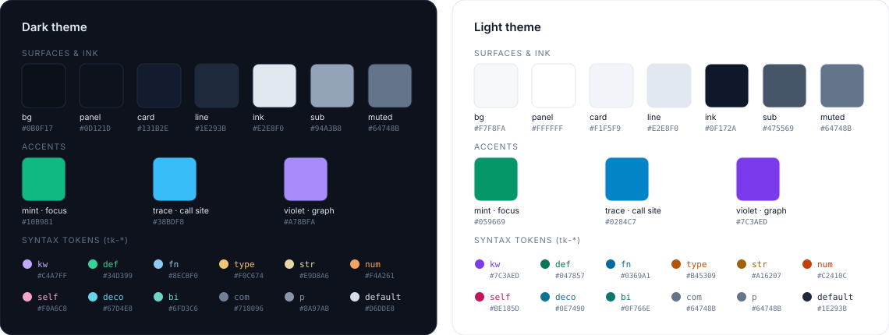

# Design system

The Tracex workspace is a dense, keyboard-first IDE surface. The golden reference is
`tracex-workspace.html`, a local design file that is deliberately not committed. Its tokens
are ported verbatim into
[`frontend/src/app/globals.css`](../frontend/src/app/globals.css) and
[`tailwind.config.ts`](../frontend/tailwind.config.ts).

<p align="center">
  
</p>

<sub>Generated from the token tables below by <a href="scripts/build_palette_svg.py"><code>docs/scripts/build_palette_svg.py</code></a>.</sub>

## Principles

1. **Code is the hero.** Chrome recedes into hairline borders and muted ink, and colour is
   reserved for meaning.
2. **Every colour means one thing.** Mint is the focus, cyan is a traced call site, violet is the
   graph. They never decorate.
3. **Explain, don't decorate.** Every badge, bar and highlight can be interrogated:
   hover it and it says why.
4. **Keyboard first.** Every primary action has a key, and the shortcut sheet is one `?` away.

## Colour tokens

Tokens are space-separated RGB channels, so Tailwind opacity modifiers work
(`bg-mint/10` → `rgb(var(--mint) / 0.1)`).

| Token | Dark | Light | Role |
|---|---|---|---|
| `--bg` | `#0B0F17` | `#F7F8FA` | Canvas (code area) |
| `--panel` | `#0D121D` | `#FFFFFF` | Header, side panels, status bar, popover glass |
| `--card` | `#131B2E` | `#F1F5F9` | Hover wash, selected rows, graph nodes |
| `--line` | `#1E293B` | `#E2E8F0` | Hairline borders, gridlines, inactive switches |
| `--ink` | `#E2E8F0` | `#0F172A` | Primary text |
| `--sub` | `#94A3B8` | `#475569` | Secondary text, unselected node strokes |
| `--muted` | `#64748B` | `#64748B` | Labels, line numbers, hints |
| `--mint` | `#10B981` | `#059669` | **Focus**: current symbol, highlight band, active state |
| `--trace` | `#38BDF8` | `#0284C7` | **Trace**: selected call site, cyan bands, `/path` tokens |
| `--violet` | `#A78BFA` | `#7C3AED` | **Graph**: graph pillar, `#route` tokens |

Semantic pairings used throughout:

| Concept | Colour | Where |
|---|---|---|
| Dense pillar · "Semantic" badge | mint | Pillar switch dot, RRF bar segment |
| BM25 pillar · "Keyword" / "Exact" badges | trace | Pillar switch dot, RRF bar segment |
| Graph pillar · "Call Graph" badge | violet | Pillar switch dot, RRF bar segment |
| `@symbol` · `#route` · `/path` | mint · violet · trace | Live command-bar tokens |

## Typography

| Use | Face | Size / weight |
|---|---|---|
| UI base | Inter (`--font-inter`) | 13px / 400 |
| Section labels | Inter | 10.5–11px / 500, uppercase, 0.08em tracking |
| Product name | Inter | 14px / 600, tight tracking |
| Code, paths, symbols, numbers | JetBrains Mono (`--font-mono`) | 12.5px code · 11–12px metadata |
| Keycaps | JetBrains Mono | 10.5px in 20px bordered boxes |

Both faces are self-hosted by `next/font`. Numbers in tables and telemetry use the mono face so
columns align.

## Layout

```text
┌──────────────────────────── header 48px ───────────────────────────────┐
│ logo · repo chip      [ ⌘K command bar ≤ 580px ]       [ ] ? · theme   │
├────────────┬──────────────────────────────────────┬────────────────────┤
│ results    │ breadcrumbs · range label     44px   │ tabs         44px  │
│ 300px      │                                      │ graph canvas 400px │
│ (rail 44)  │ code · 24px lines · 64px gutter      │ node card          │
│            │                                      │ 360px (rail 44)    │
├────────────┴──────────────────────────────────────┴────────────────────┤
│ status 28px: index state · telemetry popover · language                │
└────────────────────────────────────────────────────────────────────────┘
```

* Side panels collapse to 44px rails (`[` and `]`), animating width over 0.32s with
  `cubic-bezier(.2,.8,.2,1)`. Below 960px both start collapsed.
* Code lines are fixed at 24px high, so highlight bands and the action pill are positioned
  arithmetically (`top = 24 + (line − 1) × 24`) and glide between ranges.

## Components

| Component | Anatomy | States |
|---|---|---|
| **Command bar** | Search icon · transparent input over a coloured mirror layer · pillar dots · ⌘K keycap | `focus-within` mint border; help dropdown while typing |
| **Pillar switch** | Colour dot · name + description · 30×18 switch | `aria-checked` animates the knob 12px and tints the track mint |
| **Hit card** | Qualified name · origin badge · `file:start-end` · first code line | `aria-current` → card background + 2px mint left rule |
| **Origin badge** | 10.5px label on a 9% tint of its colour | Hover or focus opens the RRF popover |
| **RRF popover** | Score · stacked 6px contribution bar · rank/share grid · reasons · formula | Glass (`panel/86%` + 16px blur), 0.18s rise |
| **Highlight band** | 8px-radius wash plus a 2px glowing left rule | Mint (focus) or cyan (`.trace`); one band per contiguous range |
| **Action pill** | Copy Link · Find Callers · Open Graph | Appears on code hover; peeks for 1.6s after a focus change |
| **Graph node** | Mono label · `file:line` · `+N callers/callees` pills | Focus: mint border + glow · selected: cyan · hover: sub border |
| **Edges** | Smoothstep with arrowheads | Hover animates; edges touching the focus are mint at 55%; the traced edge is cyan |
| **Status bar** | Breathing dot · index state · node count | Opens the telemetry popover: stage latency bars, models, parsers |

## Motion

| Token | Value | Used by |
|---|---|---|
| Panel | 0.32s `cubic-bezier(.2,.8,.2,1)` | Side panel width |
| Glide | 0.38s same curve | Highlight band and pill position |
| Fade | 0.25–0.30s ease, 3px rise | Result lists, code swaps, graph |
| Popover | 0.18s, scale 0.98 → 1 | Every `.pop` surface |
| Breathe | 3.6s opacity loop | Index-ready dot |

`prefers-reduced-motion: reduce` disables every animation and transition.

## Syntax highlighting

Shiki TextMate grammars (Python, TypeScript, TSX) emit scope stacks, which
`classifyScopes` maps onto the golden classes. That is how a definition can be
coloured differently from a call.

| Class | Dark | Light | Scopes (abridged) |
|---|---|---|---|
| `tk-kw` | `#C4A7FF` | `#7C3AED` | `keyword.*`, `storage.type`, `constant.language`, `new` |
| `tk-def` (600) | `#34D399` | `#047857` | `entity.name.function` outside calls, `entity.name.type.class` |
| `tk-fn` | `#8ECBF0` | `#0369A1` | function names inside `meta.function-call` |
| `tk-type` | `#F0C674` | `#B45309` | `entity.name.type`, inherited classes, capitalised calls |
| `tk-str` | `#E9D8A6` | `#A16207` | `string.*` (including delimiters) |
| `tk-num` | `#F4A261` | `#C2410C` | `constant.numeric` |
| `tk-self` (italic) | `#F0A6C8` | `#BE185D` | `self`, `cls`, `this` |
| `tk-deco` | `#67D4E8` | `#0E7490` | decorators (Python and TS) |
| `tk-bi` | `#6FD3C6` | `#0F766E` | builtins, primitive types |
| `tk-com` (italic) | `#718096` | `#64748B` | `comment.*` |
| `tk-p` | `#8A97AB` | `#64748B` | punctuation, operators |

## Logo

<p>
  
  &nbsp;&nbsp;
  
</p>

The mark is the product in one glyph. Two **callers** (slate) flow into the ringed
**focus** (mint), which traces down to a **callee** (cyan). This is exactly what trace mode
shows.

| Asset | Use |
|---|---|
| [`tracex-mark.svg`](assets/tracex-mark.svg) | README and docs. Transparent; strokes adapt to light and dark schemes. |
| [`tracex-favicon.svg`](assets/tracex-favicon.svg) | Browser tab (`frontend/src/app/icon.svg`). Dark tile, no halo, heavier strokes for 16px. |
| [`social-preview.png`](assets/social-preview.png) | 1280×640 GitHub social card |
| [`tracex-typing.svg`](assets/tracex-typing.svg) | README hero animation (SMIL; [generator](scripts/build_typing_svg.py)) |

Keep clear space of at least one focus-node diameter around the mark. Never recolour
the roles: the focus is always mint and the callee always cyan.

## Charts in the docs

The figures in [benchmarks.md](benchmarks.md) follow the same discipline:

* Each retrieval configuration has one fixed categorical colour across every figure,
  validated for colour-vision deficiency in both themes. The worst adjacent CVD ΔE is 9.1 in
  light and 8.4 in dark.
* Light and dark variants are each rendered against their own surface and served with
  `<picture>`.
* Significance is encoded by filled versus hollow markers, never by colour alone.
* Every figure has a table twin.

## Accessibility

* A visible 2px mint `:focus-visible` ring everywhere. The command bar uses its border instead
  of a second ring.
* Landmarks and roles: `banner` header, `aside` panels with labels, `role="list"` results,
  `tablist`/`tab`, `switch` with `aria-checked`, `tooltip`, `dialog` / `aria-modal` for
  shortcuts.
* Colour is never the only channel. Badges carry text, significance uses marker fill, and the
  traced range is also named in the header (`L34 · traced`).
* The full keyboard model is in the `?` sheet: `⌘K` `/` `j` `k` `[` `]` `g d` `Esc`
  Click/Shift+Click.
