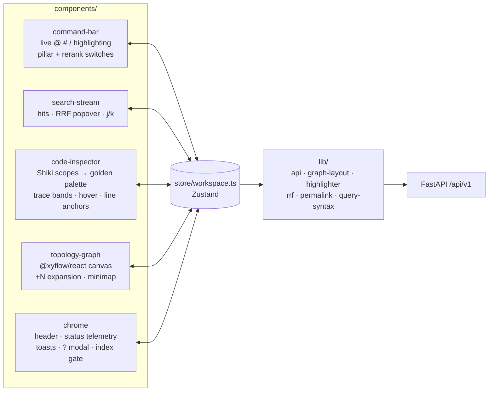
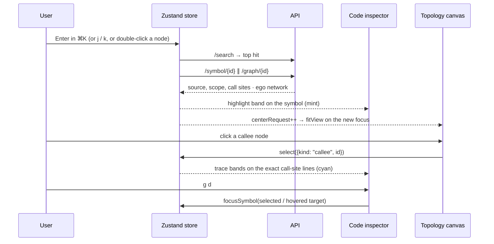

# Tracex Workspace (Phase 4)

A Next.js 15 / TypeScript rebuild of the golden UI reference (`tracex-workspace.html`),
wired to the Phase 3 API. Every rank, call-site line, latency and parser version on
screen is real.

```bash
pnpm install
pnpm dev            # http://localhost:3000, proxies /api/v1 → http://127.0.0.1:8000
pnpm test           # Vitest: lib, store, components, keyboard model
pnpm typecheck && pnpm lint && pnpm build
```

Start the backend first (from `backend/`):

```bash
TRACEX_REPO=eval/corpora/billing_service TRACEX_RERANKER=1 uv run uvicorn app.api.main:app --port 8000
```

> [!NOTE]
> `next.config.ts` rewrites `/api/v1/*` to `TRACEX_API_URL` (default
> `http://127.0.0.1:8000`), so the browser stays same-origin and no CORS setup is needed.

## Architecture



### Bi-directional focus sync



## Feature map

| Spec requirement | Implementation |
| --- | --- |
| Infinite pan/zoom topology | `@xyflow/react` with custom `SymbolNode`. Callers above, focus centred, callees below, each layer wrapped into a 2-column grid. Minimap, controls, 1–3 hop selector. |
| `+N callers/callees` expansion | Expander pills on nodes. `mergeExpansion` adds the neighbour layer, relayouts, and recomputes hidden counts from fan-in/fan-out. |
| Animated directional edges | Arrowed smoothstep edges. Hovering a node or edge animates its edges, and the selected trace edge turns cyan. |
| Bi-directional focus sync | One store: search ⇄ inspector ⇄ canvas. Stale responses are dropped (last click wins). |
| Trace mode | A callee traces its exact `call_lines` in the focus. A caller traces the focus header. Non-contiguous lines get separate bands. |
| RRF explainability popover | Hover the origin badge: stacked contribution bar, per-pillar rank and share, matched terms, Σ w/(60 + r). |
| Prefix-aware command palette | A transparent-text input over a colored mirror layer keeps native caret, IME and selection. Includes a prefix help dropdown and pillar/rerank switches. |
| Token hover tooltips | Identifiers resolve against `call_sites` (target or external), parameters and locals. |
| Line numbers | Click to anchor, Shift+Click for a range. The URL becomes `?symbol=…#L12-L18`, and deep links restore on load. |
| Floating action pill | Copy Link · Find Callers · Open Graph |
| Keyboard | `⌘K` `/` `j` `k` `[` `]` `g d` `Esc` `?`. `handleShortcut` is a pure, tested dispatcher. |
| Design system | Tokens, typography, panel widths, animations and reduced-motion handling ported verbatim from the golden HTML, in dark and light themes. |

> [!IMPORTANT]
> **Highlighting is grammar-accurate, not regex.** Shiki's TextMate grammars (Python,
> TypeScript, TSX; JS regex engine, lazily loaded) produce scope stacks, and
> `classifyScopes` maps them onto the golden `tk-*` palette. This distinguishes
> definitions from calls, `self`/`this`, decorators, builtins and types. Identifiers
> stay separate tokens so hover tooltips can attach to them.

> [!WARNING]
> Hover tooltips come from the AST index (call graph and scope tables), not from a
> language server. Calls that the static resolver could not type (e.g. into
> third-party libraries) show as "external or unresolved".

## Verification

- `pnpm test`: 55 Vitest tests. They use **real API payloads** captured from the backend
  (`tests/fixtures/*.json`), so the TypeScript types are checked against what the
  server actually returns.
- End-to-end: the production build was driven in headless Edge against the real API
  (jina-embeddings-v2 and the cross-encoder). That run covered search, RRF popover,
  callee trace, token tooltip, `g d`, `+N` expansion, Shift+Click ranges, both tabs,
  telemetry, rerank, path filters, the shortcut modal, light theme, deep-link restore
  and a 900 px viewport, with zero console errors.
