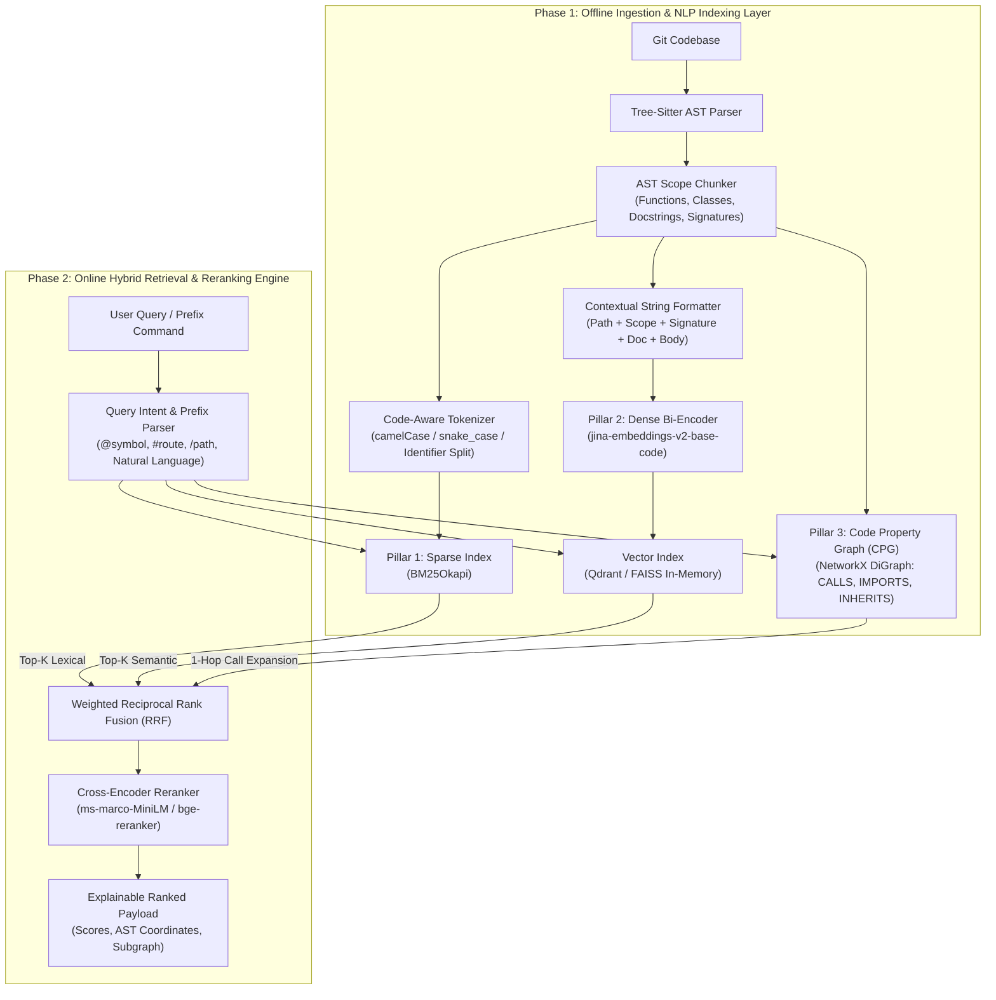
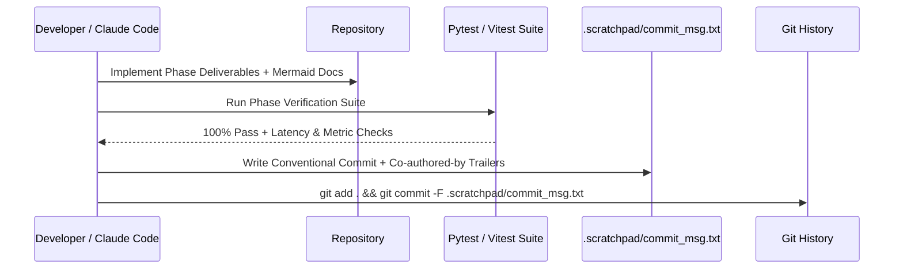

# Tracex: Hybrid NLP Codebase Intelligence & Navigation Engine
**Master Engineering Specification, NLP Research Blueprint & Claude Code Execution Prompt**

> [!IMPORTANT]
> **Primary Academic & Engineering Focus:** This project is built for a university Natural Language Processing (NLP) course. The evaluation, architectural rigor, and documentation must prioritize **NLP techniques for source code** (AST-aware semantic chunking, sub-token lexical tokenization, dual-encoder dense code embeddings, Reciprocal Rank Fusion, Graph-augmented structural retrieval, and Cross-Encoder reranking), seamlessly paired with an elite top 1% UI/UX developer workbench.

---

## 1. System Architecture & NLP Pipeline Overview

Pure vector RAG fails on source code because code is strictly hierarchical, syntactically constrained, and non-local. **Tracex** solves this via a **Tri-Pillar Hybrid Retrieval + Cross-Encoder Reranking** pipeline.



---

## 2. Repository Directory Structure

```text
tracex/
├── tracex-workspace.html          # GOLDEN UI/UX REFERENCE (Keep in root)
├── TRACEX_MASTER_SPEC.md          # Master Architectural Spec & Prompt
├── .scratchpad/                   # Git commit messages & phase notes for `git commit -F`
│   └── commit_msg.txt
├── backend/                       # Python 3.11+ NLP & FastAPI Engine
│   ├── pyproject.toml
│   ├── src/
│   │   ├── inference/             # Phase 1: AST Chunking, Tokenization, Embeddings
│   │   │   ├── ast_parser.py      # Tree-sitter multi-language bindings
│   │   │   ├── tokenizer.py       # Code-specific identifier sub-tokenization
│   │   │   └── embedder.py        # Dense code representation & batch inference
│   │   ├── retrieval/             # Phase 2: BM25, Dense, Graph & RRF Fusion
│   │   │   ├── bm25_index.py
│   │   │   ├── vector_index.py
│   │   │   ├── call_graph.py      # NetworkX AST Call & Dependency Graph
│   │   │   ├── rrf_fusion.py      # Reciprocal Rank Fusion & Explainability
│   │   │   └── reranker.py        # Cross-Encoder semantic reranking
│   │   ├── api/                   # Phase 3: FastAPI REST & Telemetry Layer
│   │   │   ├── main.py
│   │   │   ├── schemas.py         # Pydantic v2 strict contracts
│   │   │   └── routes.py          # /search, /graph, /symbol/{id}, /evaluate
│   │   └── evaluation/            # NLP Course Ablation & Metrics Suite
│   │       └── benchmark.py       # MRR@K, Recall@K, NDCG@K, Ablation runner
│   └── tests/
└── frontend/                      # Phase 4: Next.js 15 + TypeScript (pnpm)
    ├── package.json
    ├── pnpm-lock.yaml
    └── src/
        ├── app/
        ├── components/
        │   ├── command-bar/       # Spotlight with @symbol, #route, /path prefixes
        │   ├── search-stream/     # RRF Explainability cards & j/k navigation
        │   ├── code-inspector/    # Shiki / Monaco with LSP hover & line anchors
        │   └── topology-graph/    # @xyflow/react infinite canvas + minimap
        └── store/                 # Zustand bi-directional focus sync
```

---

## 3. Deep Dive: NLP Mathematical Formulations & Engineering

> [!NOTE]
> Use these exact mathematical definitions in the codebase docstrings and project report to satisfy university NLP grading criteria.

### 3.1 AST-Driven Structural Chunking & Contextualized Serialization
Instead of naive sliding-window character chunking (which severs function bodies and orphans docstrings), each AST node $u \in V_{\text{AST}}$ of type `function_definition`, `method_definition`, or `class_definition` is extracted into a structured chunk $c_i$:
$$\text{Serialize}(c_i) = \texttt{File: } f_i \oplus \texttt{Scope: } s_i \oplus \texttt{Signature: } \text{sig}_i \oplus \texttt{Docstring: } d_i \oplus \texttt{Body: } b_i$$
where $\oplus$ denotes newline-delimited structural concatenation prior to tokenization.

### 3.2 Code-Specific Sub-Tokenization (Sparse Pillar)
Standard NLP tokenizers treat `validateWebhookSignature` as a single out-of-vocabulary (OOV) token. Our custom lexical analyzer splits identifiers along `camelCase`, `PascalCase`, `snake_case`, and numeric boundaries while preserving the exact original identifier token:
$$\tau(\texttt{check\_limit}) = \{\texttt{check\_limit}, \texttt{check}, \texttt{limit}\}$$
Given query tokens $Q = \{q_1, \dots, q_m\}$, the BM25 score for code chunk $D$ is:
$$\text{Score}_{\text{BM25}}(D, Q) = \sum_{i=1}^{m} \text{IDF}(q_i) \cdot \frac{f(q_i, D) \cdot (k_1 + 1)}{f(q_i, D) + k_1 \cdot \left(1 - b + b \cdot \frac{|D|}{\text{avgdl}}\right)}$$
with code-tuned hyperparameters $k_1 = 1.2$ and $b = 0.75$.

### 3.3 Dense Bi-Encoder Representation (Semantic Pillar)
Both the natural language query $Q$ and serialized code chunk $c_i$ are projected into a shared $d$-dimensional latent space ($\mathbb{R}^{768}$) via a code-pretrained Transformer encoder $E_{\theta}$ (e.g., `jinaai/jina-embeddings-v2-base-code`):
$$\text{Score}_{\text{Dense}}(c_i, Q) = \frac{E_{\theta}(Q)^\top E_{\theta}(\text{Serialize}(c_i))}{\|E_{\theta}(Q)\|_2 \|E_{\theta}(\text{Serialize}(c_i))\|_2}$$

### 3.4 Code Property Graph (CPG) & Structural Expansion (Graph Pillar)
We construct a directed graph $G = (V, E)$ in `NetworkX` where vertices $V$ are indexed symbols and edges $E \subseteq V \times V \times \{\texttt{CALLS}, \texttt{IMPORTS}, \texttt{INHERITS}\}$.
Given top seed nodes $S_0 \subset V$ from Dense and BM25 retrieval, the 1-hop structural neighborhood $N_1(S_0)$ is scored by personalized PageRank / degree-damped proximity:
$$\text{Score}_{\text{Graph}}(u) = \sum_{v \in S_0, (u,v) \in E \lor (v,u) \in E} \frac{\text{Score}_{\text{Seed}}(v)}{1 + \ln(1 + \text{deg}(u))}$$

### 3.5 Weighted Reciprocal Rank Fusion (RRF) & Cross-Encoder Reranking
Ranks $r_m(d)$ across retrieval pillars $m \in \{\text{Dense}, \text{BM25}, \text{Graph}\}$ are fused via weighted RRF:
$$\text{RRF}(d) = \sum_{m} w_m \cdot \frac{1}{k_{\text{rrf}} + r_m(d)}, \quad k_{\text{rrf}} = 60, \quad \sum_m w_m = 1$$
Top-20 fused candidates are subsequently scored by a Cross-Encoder $f_{\text{cross}}(Q \oplus \text{Serialize}(d)) \to [0, 1]$ to capture full token-level cross-attention between query words and code tokens.

### 3.6 NLP Course Evaluation Metrics
The `evaluation/benchmark.py` module must compute:
1. **Mean Reciprocal Rank ($\text{MRR}@K$):**
   $$\text{MRR}@K = \frac{1}{|Q|} \sum_{i=1}^{|Q|} \frac{1}{\text{rank}_i}$$
2. **Normalized Discounted Cumulative Gain ($\text{NDCG}@K$):**
   $$\text{NDCG}@K = \frac{\text{DCG}@K}{\text{IDCG}@K}, \quad \text{DCG}@K = \sum_{p=1}^{K} \frac{2^{\text{rel}_p} - 1}{\log_2(p + 1)}$$
3. **Recall@$K$** across 4 ablation configurations: *BM25-Only*, *Dense-Only*, *Dense + BM25*, and *Full Tracex Hybrid (Dense + BM25 + AST Graph + Reranker)*.

---

## 4. Phased Implementation Plan & Git Checkpointing Protocol

> [!TIP]
> **Git Checkpoint Protocol for Claude Code:**
> At the end of **every single phase**, before starting the next phase:
> 1. Run all unit tests and verification checks for that phase.
> 2. Write a structured, conventional commit message to `.scratchpad/commit_msg.txt` including architectural highlights and `Co-authored-by:` trailers for all project collaborators.
> 3. Stage files and execute `git commit -F .scratchpad/commit_msg.txt`.



---

### Phase 1: The Inference Layer (AST Parsing, Chunking & Embeddings)
**Objective:** Build the deterministic AST extraction and neural/lexical representation layer.
* **Deliverables:**
  1. `backend/src/inference/ast_parser.py`: `tree-sitter` parser supporting Python, TypeScript, and Go. Extracts `SymbolNode` objects containing `symbol_id`, `qualified_name`, `kind` (`function`, `method`, `class`), `file_path`, `start_line`, `end_line`, `signature`, `docstring`, `parent_scope`, `imports`, `calls` (outgoing AST `call` identifiers), and `ast_scope_details` (params, locals, raises, returns).
  2. `backend/src/inference/tokenizer.py`: Code-aware lexical tokenizer splitting `camelCase`, `PascalCase`, `snake_case`, and preserving exact identifiers alongside docstrings.
  3. `backend/src/inference/embedder.py`: Dense embedding wrapper supporting `jinaai/jina-embeddings-v2-base-code` (or lightweight `all-MiniLM-L6-v2` fallback for fast CPU CI tests) with L2 normalization and batch caching.
  4. Documentation in `backend/src/inference/README.md` with Mermaid AST traversal diagrams and GitHub callouts.
* **Phase 1 Checkpoint:** Write `.scratchpad/commit_msg.txt` (`feat(inference): implement tree-sitter AST scope chunker and dense/sparse code encoders`) and commit via `git commit -F .scratchpad/commit_msg.txt`.

---

### Phase 2: Hybrid Retrieval, Call Graph & RRF Ranking Engine
**Objective:** Build the 3-pillar index, NetworkX Call Graph, RRF combiner, and NLP evaluation harness.
* **Deliverables:**
  1. `backend/src/retrieval/bm25_index.py`: Sub-token aware BM25 index returning ranked hits and matched query terms.
  2. `backend/src/retrieval/vector_index.py`: Exact cosine similarity vector search over normalized dense embeddings.
  3. `backend/src/retrieval/call_graph.py`: `NetworkX` directed graph resolving AST call targets across files, calculating `fan_in` (in-degree), `fan_out` (out-degree), upstream callers, downstream callees, and 1-hop graph expansion scores.
  4. `backend/src/retrieval/rrf_fusion.py`: Weighted Reciprocal Rank Fusion ($k=60$ or configurable $k$) returning per-pillar rank breakdowns:
     $$\text{Score}(d) = w_{\text{Dense}}\text{RRF}_{\text{Dense}}(d) + w_{\text{BM25}}\text{RRF}_{\text{BM25}}(d) + w_{\text{Graph}}\text{RRF}_{\text{Graph}}(d)$$
  5. `backend/src/evaluation/benchmark.py`: Automated evaluation script running ablation studies (BM25 vs. Dense vs. Hybrid + Graph) and outputting a Markdown table of $\text{MRR}@5$, $\text{NDCG}@5$, and $\text{Recall}@5$.
* **Phase 2 Checkpoint:** Write `.scratchpad/commit_msg.txt` (`feat(retrieval): implement BM25, dense vector, NetworkX call graph and RRF fusion engine`) and commit via `git commit -F .scratchpad/commit_msg.txt`.

---

### Phase 3: FastAPI Service & Explainable Telemetry Layer
**Objective:** Expose high-speed, stateless REST endpoints tailored to the frontend workspace.
* **Deliverables:**
  1. `GET /api/v1/search`: Accepts `q` (supports prefixes `@symbol`, `#route`, `/filepath`), pillar toggles (`dense`, `bm25`, `graph`), and `top_k`. Returns ranked hits with exact RRF score decomposition (`dense_rank`, `bm25_rank`, `graph_rank`, `rrf_score`, `match_origin`), snippet, and stage-by-stage millisecond latency telemetry (`embedding_ms`, `bm25_ms`, `ast_graph_ms`, `rrf_ms`, `total_ms`).
  2. `GET /api/v1/symbol/{symbol_id}`: Returns full file source code, AST scope table (`params`, `locals`, `raises`, `returns`), exact highlight coordinates, and module imports.
  3. `GET /api/v1/graph/{symbol_id}`: Returns ego-network call topology (upstream callers, focus node, downstream callees, `fan_in`, `fan_out`, and expandable `+N` leaf indicators) formatted for `@xyflow/react`.
  4. `POST /api/v1/index`: Triggers repository indexing and returns node/edge counts and parser versions.
* **Phase 3 Checkpoint:** Write `.scratchpad/commit_msg.txt` (`feat(api): expose FastAPI hybrid search, symbol inspector, and call graph endpoints`) and commit via `git commit -F .scratchpad/commit_msg.txt`.

---

### Phase 4: Top 1% Elite Next.js / TypeScript Frontend (`pnpm`)
**Objective:** Rebuild `tracex-workspace.html` into a modular Next.js 15 + TypeScript application using `pnpm`, adding the Top 1% UI/UX upgrades.
* **Design System Mandate:** Preserve all CSS variables, color tokens (`#090D13` canvas, `#0D121D` panel, `#131B2E` card, `#10B981` mint focus, `#38BDF8` trace cyan, `#A78BFA` graph violet, `rgba(255,255,255,0.06)` translucent borders), and typography (`Inter` + `JetBrains Mono`) from `tracex-workspace.html`.
* **Top 1% UX Features Required:**
  1. **Infinite Pan/Zoom Topology Canvas (`@xyflow/react`):** Custom SVG/ReactFlow nodes with animated directional call edges on hover, pan/zoom controls, minimap, and `+N callers/callees` multi-hop expansion buttons.
  2. **Bi-Directional Focus Sync (Zustand):** Clicking a search hit updates the Code Inspector and centers the React Flow node. Clicking a caller/callee node highlights the exact call-site lines in cyan (`trace` mode); double-clicking navigates into its definition.
  3. **Explainable RRF Breakdown Popover:** Hovering over any search hit's match badge reveals the mathematical RRF contribution bar (`Dense + BM25 + Graph`) and exact match justification.
  4. **Prefix-Aware Command Palette (`⌘K`):** Live syntax highlighting for `@symbol`, `#route`, and `/filepath` tokens inside the spotlight input, plus pillar toggle switches.
  5. **Interactive Code Inspector:** Token-level hover tooltips, clickable line numbers (`Click` to anchor, `Shift+Click` for range permalink), floating action pill (`Copy Link`, `Find Callers`, `Open Graph`), and full keyboard navigation (`[`, `]`, `j`, `k`, `/`, `g d`, `?` shortcut modal).
* **Phase 4 Checkpoint:** Write `.scratchpad/commit_msg.txt` (`feat(frontend): build Next.js context-adaptive IDE workspace with React Flow and Shiki`) and commit via `git commit -F .scratchpad/commit_msg.txt`.

---

## 5. Ready-to-Use Master Prompt for Claude Code

Copy and paste the block below directly into **Claude Code** to execute the build autonomously phase-by-phase:

```markdown
You are an elite Staff NLP & Full-Stack Systems Engineer building **Tracex** — an AST-Aware Hybrid NLP Codebase Semantic Search and Dependency Intelligence System.

Read `TRACEX_MASTER_SPEC.md` and `tracex-workspace.html` in the repository root before writing any code. `tracex-workspace.html` is our golden UI/UX reference; keep it untouched in the repository root.

### Core Execution Rules:
1. **Strict Phased Execution:** Execute the project strictly in 4 sequential phases:
   - **Phase 1:** Inference Layer (`backend/src/inference/` — Tree-Sitter AST parser, code-aware sub-tokenizer, dense embedding generator, and unit tests).
   - **Phase 2:** Hybrid Retrieval & RRF Ranking Engine (`backend/src/retrieval/` & `backend/src/evaluation/` — BM25, Dense Vector Index, NetworkX Call Graph, Weighted RRF Fusion, Cross-Encoder reranking hook, and NLP ablation benchmark suite computing MRR@5, NDCG@5, and Recall@5).
   - **Phase 3:** FastAPI Backend (`backend/src/api/` — `/api/v1/search`, `/api/v1/symbol/{id}`, `/api/v1/graph/{id}`, `/api/v1/index` with sub-millisecond stage telemetry and Pydantic v2 schemas).
   - **Phase 4:** Next.js + TypeScript Frontend (`frontend/` using `pnpm`, `@xyflow/react`, `zustand`, Tailwind CSS) implementing the exact visual identity of `tracex-workspace.html` plus the Top 1% UX upgrades (infinite pan/zoom graph, RRF score explainability breakdown, prefix filters `@symbol`/`#route`/`/path`, line-range selection, and full keyboard navigation `[`, `]`, `j`, `k`, `⌘K`, `?`).

2. **Git Checkpointing via Scratchpad (`git commit -F`):**
   - Create a `.scratchpad/` directory (add `.scratchpad/` to `.gitignore` so temporary scratch files never pollute the repo).
   - At the end of EACH phase, run the test suite to verify 100% pass rate.
   - Generate a comprehensive, conventional commit message in `.scratchpad/commit_msg.txt` detailing the NLP/engineering components implemented in that phase.
   - Append `Co-authored-by:` trailers at the bottom of `.scratchpad/commit_msg.txt` for project collaborators (ask me for collaborator names/emails before the first commit, or use placeholders configured in `.scratchpad/collaborators.txt`).
   - Commit the phase using:
     `git add . && git commit -F .scratchpad/commit_msg.txt`

3. **Academic-Grade Documentation:**
   - Every module and `README.md` must include **Mermaid diagrams** (`flowchart`, `sequenceDiagram`, or `classDiagram`) and **GitHub native callouts** (`> [!NOTE]`, `> [!TIP]`, `> [!IMPORTANT]`, `> [!WARNING]`).
   - Document the mathematical formulations (BM25, Cosine Similarity, Weighted RRF, Graph Degree Damping, MRR, NDCG) clearly in both code docstrings and Markdown documentation.

Start now by inspecting the workspace, asking me for the collaborator `Name <email>` list for the `Co-authored-by:` git trailers (if any), and immediately commencing **Phase 1: The Inference Layer**.
```